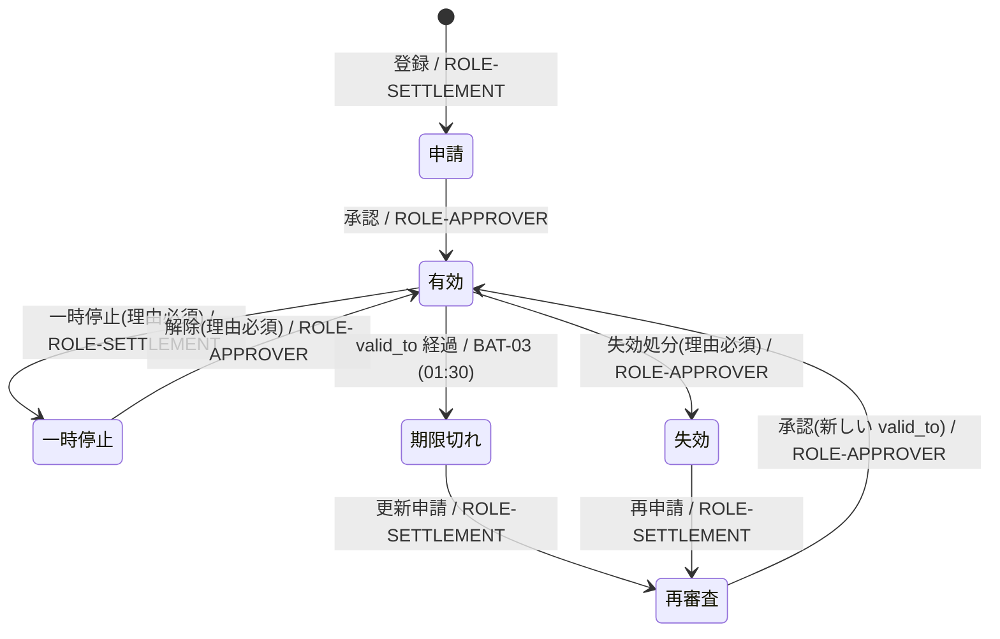
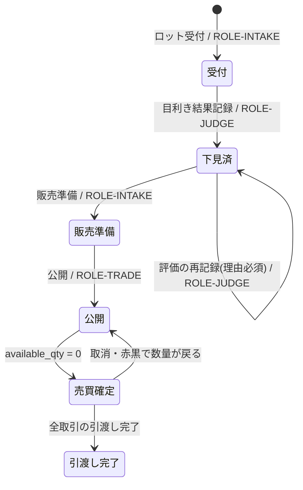
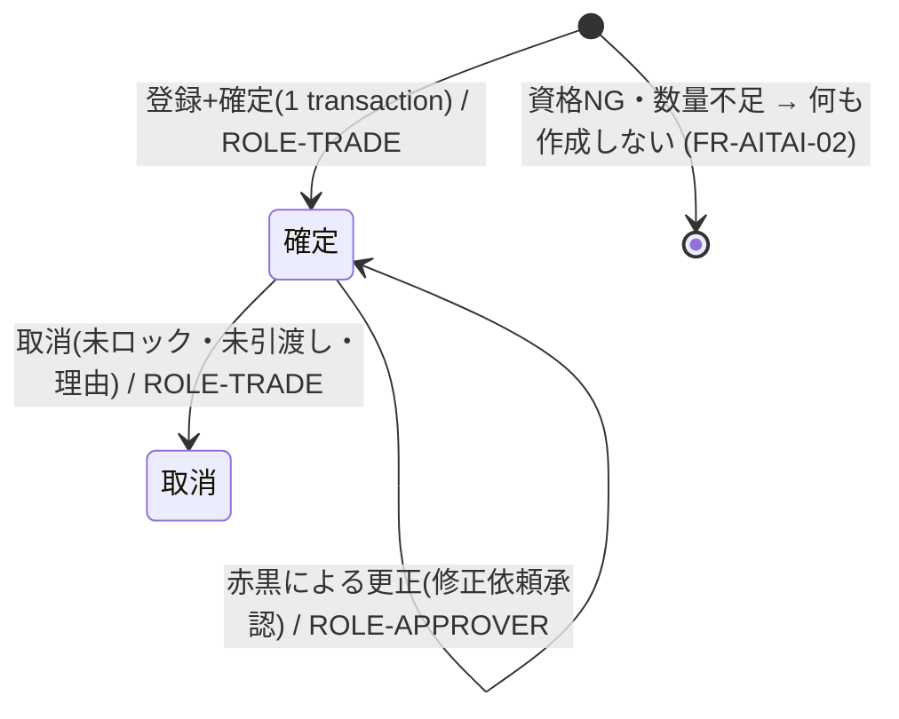
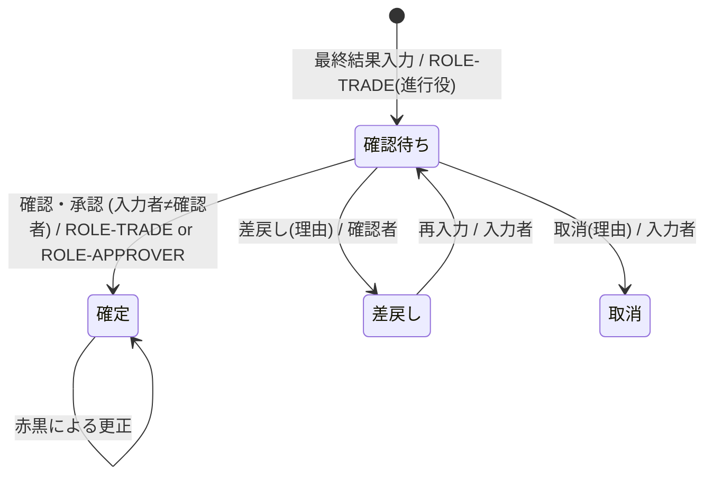
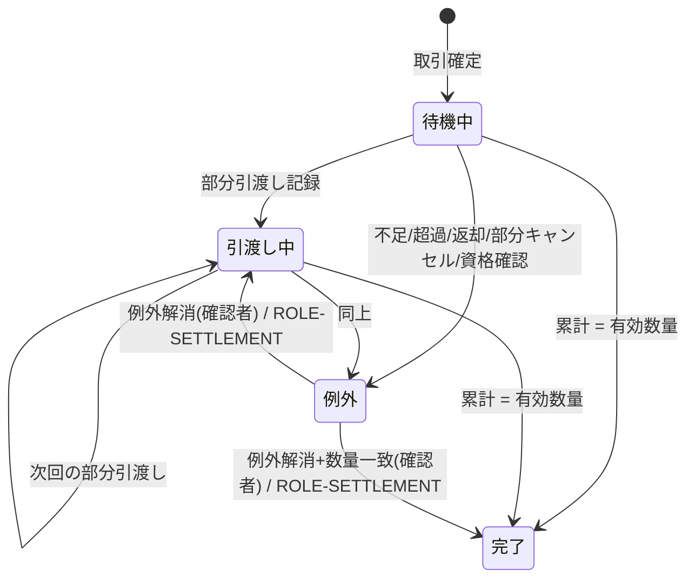
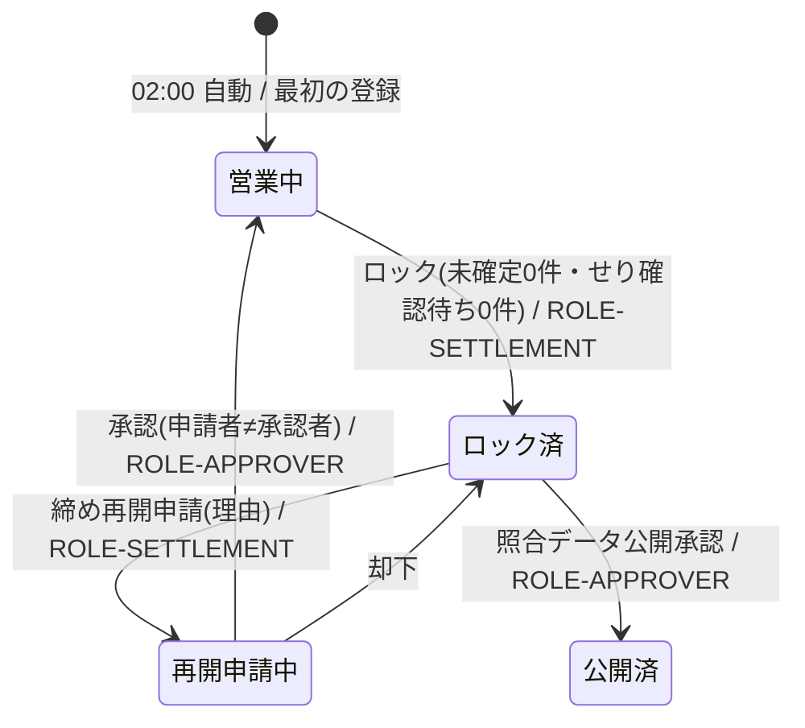
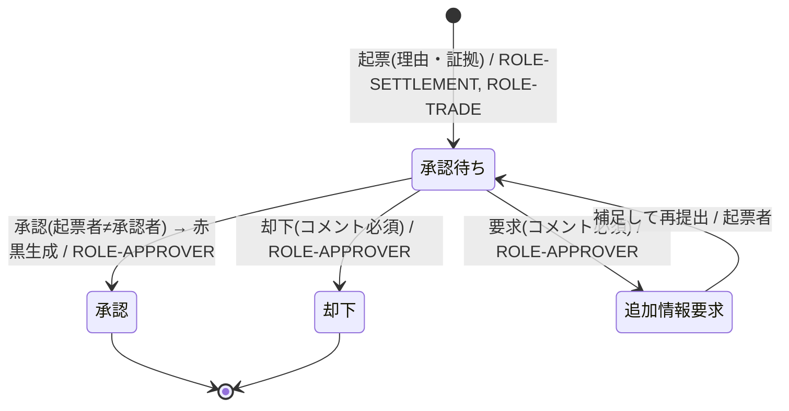
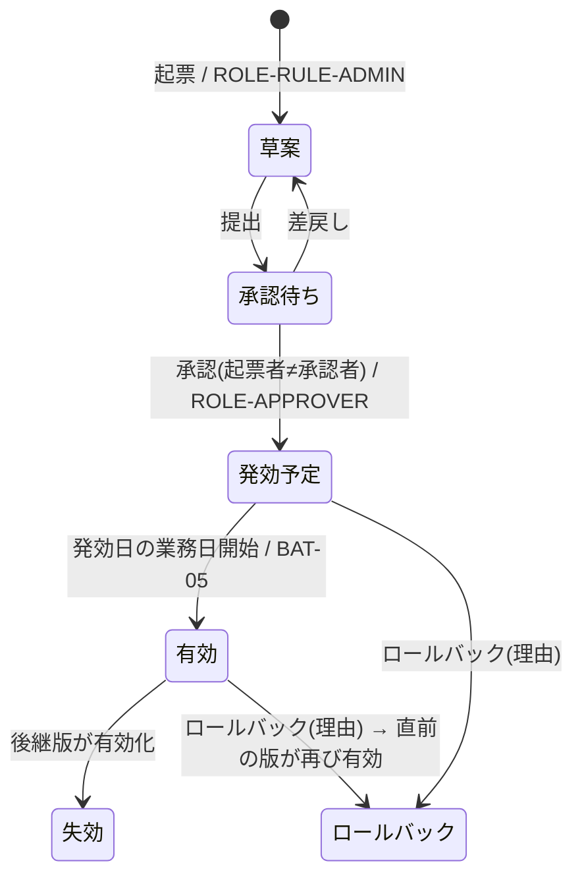

# Business Rules & State Machines — Product A 桜水産市場

> Thuộc `01_Requirement Specification` (spec-standard). File **tạo mới**, không có template công ty tương ứng — template Sun* chỉ có Function/Screen/DB/API/Detail Design, không có chỗ đặt các quy tắc nghiệp vụ dùng chung và máy trạng thái. Mọi Screen spec, API, Detail design tham chiếu tới mã quy tắc `BR-xx` / `SM-xx` trong file này thay vì viết lại.

| Mục | Giá trị |
|---|---|
| Version | 1.0 (2026-11-15) |
| Nguồn | RFP 07-01, 02-08, 03-07, 06-03, 06-04, B.2〜B.7, FIG-010〜014; Q-01〜Q-25 (LAB-1); A4-01〜A4-08 ([PREMISE](../PREMISE.md)) |

## 1. Vì sao không được làm tuyến tính chung

RFP cảnh báo ba kiểu "đơn giản hóa" dẫn tới thiết kế sai. Thiết kế này tách nhánh ở đúng các điểm đó:

| Bẫy | Nếu làm tuyến tính chung | Thiết kế tách nhánh |
|---|---|---|
| 「市場＝せり」 (12-06: lý do loại hồ sơ) | 1 luồng đấu giá chung cho mọi giao dịch | **SM-03 相対** là luồng chính, **SM-04 せり** chỉ ghi kết quả do người chốt; 2 máy trạng thái riêng, chung bảng `trades` nhưng khác trạng thái đầu và khác người được xác nhận |
| 許可 = 承認 (02-08) | 1 cờ `is_qualified` cho mọi người tham gia | 4 căn cứ tham gia riêng (BR-01), ràng buộc cố định *loại người tham gia → căn cứ*, máy trạng thái SM-01 riêng cho từng căn cứ |
| 「完納」= giao xong |奨励金 tính khi giao hàng hoàn tất | 完納 = **thanh toán đủ trước hạn** (BR-08). Luồng giao hàng (SM-05) và luồng 奨励金 (SM-08) không phụ thuộc nhau |
| Sửa trực tiếp sau khi chốt | UPDATE dòng giao dịch | Ngày đã khóa chỉ sửa bằng 赤黒 (BR-06), bản gốc giữ nguyên |
| AI/OCR thay người | Tự đánh giá chất lượng, tự đọc 手やり | 4 điểm bắt buộc người quyết (BR-11, CAP-HUMAN-01); hệ thống chỉ ghi kết quả + người + thời điểm |

## 2. Quy tắc nghiệp vụ

| ID | Quy tắc | Nguồn | Nơi cưỡng chế (ADR-003) |
|---|---|---|---|
| **BR-01** | Căn cứ tham gia theo loại: 卸売業者→`市場登録`, 仲卸→`許可`, 売買参加者→`承認`, 買出人→`取引地点登録`. Không cho đăng ký căn cứ khác loại | 02-08, B.2, FIG-004 | CHECK constraint + hàm `fn_expected_basis()` |
| **BR-02** | Tư cách được kiểm tra **tại thời điểm xác nhận** giao dịch (không phải lúc nhập nháp), theo ngày nghiệp vụ của giao dịch. Hợp lệ khi: trạng thái `有効`, `valid_from ≤ day ≤ valid_to`. `valid_to` là ngày hiệu lực cuối, có hiệu lực đến 01:59 hôm sau (Q-19) | BR-PERM-01, FR-PARTY-02 | `fn_check_eligibility()` gọi trong transaction xác nhận |
| **BR-03** | Số lượng khả dụng của lô không âm. Mọi thay đổi số lượng (xác nhận, hủy, 赤黒, điều chỉnh) ghi 1 dòng vào sổ `lot_qty_ledger`; `lots.available_qty` = tổng sổ | BR-LOT-02, FR-LOT-03 | Row lock `FOR UPDATE` trên `lots` + CHECK `available_qty >= 0` |
| **BR-04** | Ngày nghiệp vụ bắt đầu 02:00 JST. 00:00〜01:59 thuộc ngày trước. Ngày nghỉ chợ (market_calendar) không nhận giao dịch mới | BASE-03, Q-05 | `fn_business_day(ts)` |
| **BR-05** | Hủy giao dịch: chỉ khi ngày chưa khóa, chưa có giao hàng, bắt buộc lý do; trả lại số lượng cho lô | FR-AITAI-03 | `fn_cancel_trade()` |
| **BR-06** | Ngày đã khóa: không UPDATE/DELETE trực tiếp giao dịch, giao hàng, lô của ngày đó. Sửa chỉ bằng 修正依頼 → duyệt → bút toán 赤 (đảo) + 黒 (đúng) ghi vào **ngày nghiệp vụ hiện tại**, dưới cùng `trade_code` (A4-01). Ngoại lệ duy nhất: tiến độ giao hàng được ghi tiếp sau khi khóa | BR-CLOSE-01, FR-CORR-02/03, B.4 | Trigger chặn + `fn_approve_correction()` |
| **BR-07** | Giao hàng chỉ `完了` khi tổng số lượng đã giao (không tính dòng ngoại lệ) = số lượng hiệu lực của giao dịch (số của bút toán đen mới nhất). Ngoại lệ 不足/超過/返却/部分キャンセル bắt buộc lý do | BR-DEL-03, FR-DEL-02/03 | `fn_record_delivery()` |
| **BR-08** | 完納奨励金 = `floor(適格金額 × 交付率 × 110/100)` trên **tổng kỳ** của từng người mua; = 0 nếu tổng đã trả đến hết hạn (tính cả ngày hạn) < số phải trả, hoặc 適格金額 < ngưỡng. Không có thời gian ân hạn | BR-INC-01, B.5, Q-07, Q-08 | `fn_calculate_incentive()` |
| **BR-09** | Kỳ 奨励金 đã khóa không bị sửa; tính lại chỉ sinh dòng `次期差分` vào kỳ kế tiếp kèm nguyên nhân | FR-INC-03 | `incentive_periods.status` |
| **BR-10** | Bản料率: người lập ≠ người duyệt; ngày hiệu lực phải sau ngày nghiệp vụ hiện tại; tối đa 4 bản có hiệu lực trong 1 năm tài chính (A4-07); rollback = vô hiệu bản, không xóa; tính toán luôn dùng bản có hiệu lực tại **ngày cuối kỳ** | GOV-RULE-01, FR-INC-02, B.6 | `fn_resolve_rate(day)` + CHECK |
| **BR-11** | Bốn điểm người quyết: (1) đánh giá 目利き, (2) chốt kết quả せり, (3) duyệt sửa nhạy cảm, (4) hoàn tất giao hàng có tranh chấp. Hệ thống **không gợi ý, không tự quyết** ở 4 điểm này | CAP-HUMAN-01, 03-07, SCOPE-OUT-01/02 | Không có API nào tự sinh giá trị cho các trường này |
| **BR-12** | Phân tách nhiệm vụ (maker ≠ checker) cho: xác nhận せり, duyệt 修正依頼, duyệt料率版, duyệt mở lại ngày đã khóa, phát hành dữ liệu đối chiếu | 02-08 | So sánh `created_by <> actor` trong hàm DB |
| **BR-13** | Mọi thao tác tạo/sửa/duyệt/khóa/đổi quyền ghi audit (trước/sau, người, thời điểm, lý do) **trong cùng transaction** với thao tác; audit chỉ được thêm | FR-AUDIT-01, 06-04 | `fn_audit()` gọi bên trong hàm nghiệp vụ, trigger append-only |
| **BR-14** | Mỗi giao dịch có đúng 1 mã nghiệp vụ (`trade_code`) theo suốt từ lô đến báo cáo kế toán; mã không tái sử dụng, không đổi | 06-04, DOM-04 | Bảng `code_sequences` (ADR-012) |
| **BR-15** | Giao hàng khi tư cách người mua đã hết hạn/tạm dừng: cho ghi, nhưng trạng thái `例外(資格確認)`; 照合事務局 xác nhận mới được `完了` (A4-03) | FIG-014 | `fn_record_delivery()` |
| **BR-16** | Không xóa cứng dữ liệu đã dùng trong báo cáo chính thức; xóa vật lý sau thời hạn lưu cần duyệt | B.7 | Không cấp quyền DELETE cho role ứng dụng |

## 3. Máy trạng thái

Ký hiệu: `[*]` = bắt đầu/kết thúc. Mỗi mũi tên ghi *sự kiện / người được làm*.

### SM-01 Tư cách tham gia (party_qualifications) — FIG-010

Chỉ `有効` cho phép xác nhận giao dịch (BR-02). `失効間近` không phải trạng thái mà là cờ hiển thị khi `valid_to - day <= 警告日数` (mặc định 30, cấu hình được — FR-PARTY-03).

### SM-02 Lô (lots) — FIG-011

Prototype LAB-2 thiếu `販売準備` (gộp vào `公開`) và cho `ROLE-INTAKE` ghi kết quả 目利き — xem [DB §6](../02_System-Architecture/01_High-Level-Design/03_Database-Design.md#6-đối-chiếu-với-prototype-lab-2).

### SM-03 相対取引 (trade_type = 相対) — FIG-012

Không có trạng thái `下書き` lưu trong DB: thao tác nhập và xác nhận là 1 transaction. Nếu bị từ chối thì không còn bản nháp nào (FR-AITAI-02). Bản nháp chỉ tồn tại trên màn hình.

### SM-04 せり結果 (trade_type = せり) — FIG-012

Kiểm tra tư cách + số lượng chạy ở bước `確認・承認`, không phải lúc nhập.

### SM-05 Giao hàng (trades.delivery_status) — FIG-014

`例外 → 完了` luôn cần người thứ hai xác nhận (BR-11 điểm 4).

### SM-06 Ngày nghiệp vụ (business_days)

`公開済` (đã gửi kế toán) không mở lại được; chỉ sửa bằng 赤黒 vào ngày sau.

### SM-07 修正依頼 (corrections) — FORM-CORR-01

### SM-08 Kỳ 奨励金 (incentive_periods) — FIG-013

```mermaid
stateDiagram-v2
  [*] --> 未計算
  未計算 --> 計算済: 計算実行 / ROLE-SETTLEMENT
  計算済 --> 計算済: 再計算(結果を置換; 期ロック前のみ)
  計算済 --> 確定: 期ロック / ROLE-APPROVER
  確定 --> 確定: 再計算 → 次期差分のみ生成
```

### SM-09 Bản料率 (rate_versions) — GOV-RULE-01, SCR-100

## 4. Bảng quyết định: có xác nhận được giao dịch không (BR-02 + BR-03 + BR-04)

Thứ tự kiểm tra cố định — lý do từ chối đầu tiên được trả về màn hình (SCR-040 khu vực C).

| # | Điều kiện | Kết quả nếu sai | Mã lỗi |
|---|---|---|---|
| 1 | Ngày nghiệp vụ không phải ngày nghỉ chợ | Từ chối | `E-TRD-01` 休市日 |
| 2 | Ngày nghiệp vụ chưa khóa | Từ chối | `E-TRD-02` ロック済 |
| 3 | Người mua có căn cứ đúng loại (BR-01) | Từ chối | `E-ELG-01` 根拠なし |
| 4 | Căn cứ ở trạng thái `有効` (không `一時停止`/`失効`/`再審査`) | Từ chối, ghi trạng thái | `E-ELG-02` |
| 5 | `valid_from ≤ day ≤ valid_to` | Từ chối, ghi ngày hết hạn | `E-ELG-03` 期限切れ |
| 6 | Lô ở trạng thái `公開` hoặc `売買確定` | Từ chối | `E-LOT-01` |
| 7 | `available_qty ≥ qty` (đọc sau `FOR UPDATE`) | Từ chối, ghi số khả dụng | `E-LOT-02` 数量不足 |
| 8 | (せり) người xác nhận ≠ người nhập | Từ chối | `E-SOD-01` 職務分離 |

Không có kết quả "cảnh báo nhưng vẫn cho qua" ở bảng này: mọi điều kiện đều chặn (EX-TRADE-01 hiện tại phải gọi điện tạm dừng — hệ thống làm thay việc đó).
