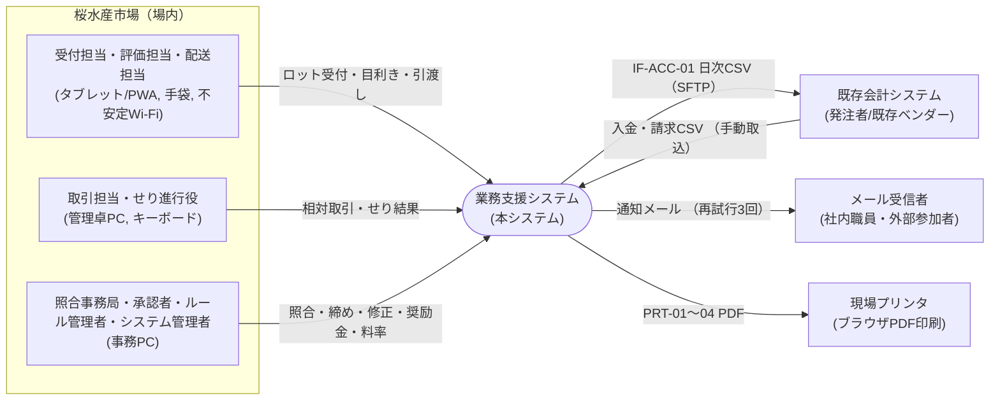
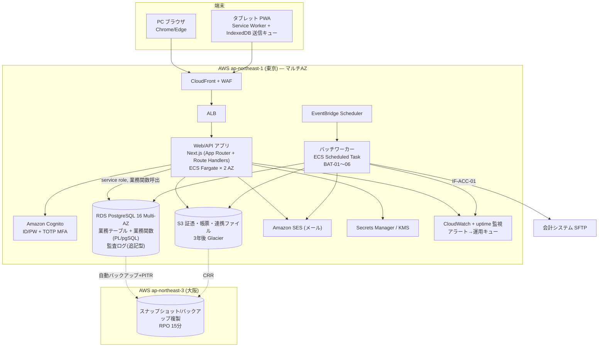
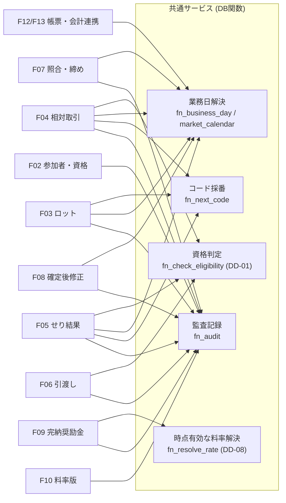
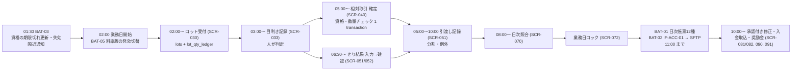

# Architecture Design — Product A 桜水産市場 業務支援システム

> Thuộc `02_System Architecture / 01_High Level Design` (spec-standard). File **tạo mới**: spec-standard không có template kiến trúc tổng thể (chỉ có Screen/Database Design ở High Level). Cấu trúc theo C4 (Context → Container → Component) + luồng dữ liệu + điểm tích hợp.

| Mục | Giá trị |
|---|---|
| Version | 1.0 (2026-11-15) |
| Quyết định liên quan | [ADR index](../../04_Other/ADR/README.md) |
| Nguồn | RFP 06-06, 08-03, 09-01〜09-04; Proposal LAB-1 slide 11〜13; prototype LAB-2 |

## 1. Bối cảnh hệ thống (C4 Level 1)

Người tham gia bên ngoài (仲卸・売買参加者・買出人) **không đăng nhập** ở phạm vi cơ bản (Q-03); họ chỉ nhận mail. Ngân hàng không kết nối (BASE-06).

## 2. Container (C4 Level 2)

| Container | Trách nhiệm | Công nghệ | Lý do chọn |
|---|---|---|---|
| Web/API app | Màn hình (49) + API (`/api/v1/**`), xác thực phiên, kiểm tra quyền thô (role → permission), gọi hàm nghiệp vụ DB | Next.js 16, TypeScript (giữ từ prototype) | Prototype đã chứng minh; 1 codebase cho FE+API giảm effort (ADR-010) |
| PWA tablet | Form SCR-030, SCR-061 dùng được khi mất mạng ≤ 30 phút | Service Worker, IndexedDB | NFR-AVL-02, Q-20 (ADR-007) |
| PostgreSQL | **Nơi cưỡng chế quy tắc nghiệp vụ** (BR-01〜BR-16): transaction + khóa dòng + trigger + audit | RDS PostgreSQL 16 Multi-AZ | Quy tắc chống bán vượt, khóa ngày phải đúng kể cả khi gọi đồng thời (ADR-003) |
| Batch worker | Báo cáo ngày, IF-ACC-01, kiểm tra hết hạn, gửi lại mail, kích hoạt料率, chuyển cold | ECS Scheduled Task, cùng image với app | Không phụ thuộc request người dùng; chạy lại được (idempotent theo `job_runs`) |
| Cognito | Đăng nhập ID/PW, MFA TOTP cho vai trò quản trị/duyệt, khóa khi sai nhiều lần | Amazon Cognito | NFR-SEC-01/03 không phải tự làm (ADR-010) |
| S3 | Ảnh chứng cứ, file CSV xuất/nhập, PDF in | S3 + lifecycle → Glacier sau 3 năm | TBL-ATTACH-01, DR-RET-01 |

## 3. Component — module nghiệp vụ

Mỗi module = 1 thư mục `src/modules/<name>` (UI + API handler) + 1 nhóm hàm DB `fn_<module>_*`. Module chỉ gọi hàm DB của chính nó; dùng chung qua 3 dịch vụ lõi.

`AITAI` và `SERI` là 2 module riêng dù ghi chung bảng `trades` — khác trạng thái đầu, khác người xác nhận, khác màn hình (ADR-001).

## 4. Luồng dữ liệu chính

### 4.1 Một ngày nghiệp vụ (02:00 → 11:00 JST)

### 4.2 Chuỗi định danh xuyên suốt (DOM-04)

`lot_code` (L261115-001) → `trade_code` (T261115-0001) → `deliveries.trade_id` + `seq` → `trade_entries` (赤黒 cùng `trade_code`) → `business_days.day` → `acc_export_batches.batch_code` (ACC-20261115-01) → `incentive_results (period, party_id)`. Mọi báo cáo truy ngược được về `trade_code`.

### 4.3 Xử lý lỗi khi xác nhận giao dịch

Hàm DB `raise exception` với mã nghiệp vụ (`E-TRD-01`…, xem [Business Rules §4](../../01_Requirement-Specification/02_Business-Rules-and-State-Machines.md#4-bảng-quyết-định-có-xác-nhận-được-giao-dịch-không-br-02--br-03--br-04)) → API trả **409** + `error_code` → màn hình hiện lý do ở vùng thông báo, focus về trường liên quan. Transaction rollback nên không còn bản ghi rác (FR-AITAI-02).

## 5. Điểm tích hợp

| ID | Hướng | Đối tác | Giao thức / định dạng | Tần suất | Lỗi & thử lại | Tài liệu |
|---|---|---|---|---|---|---|
| IF-ACC-01 | Ra | Hệ thống kế toán | CSV UTF-8 BOM (Shift_JIS cấu hình được), SFTP | 1 lần/ngày sau khóa ngày | 3 lần cách 5 phút; thất bại → Critical alert + SCR-130 cho phép gửi lại có duyệt | ADR-009, API ACC-01/02 |
| IF-PAY-01 | Vào | Hệ thống kế toán (người dùng tải về rồi upload) | CSV: 参加者コード, 対象期, 請求額, 入金額, 入金日 | Theo kỳ | Lỗi từng dòng hiện trên SCR-090, không nhận một phần | ADR-009, API INC-01 |
| IF-MAIL-01 | Ra | SES → người nhận | SMTP/API | Theo sự kiện | Tối đa 3 lần; thất bại cuối → `notifications.status='最終失敗'` + alert (BR-NOTIFY-01) | ADR-011 |
| IF-PRT-01 | Ra | Máy in tại chỗ | PDF A4 (in từ trình duyệt) | Theo thao tác | — | Q-21 |
| IF-AUTH-01 | 2 chiều | Cognito | OIDC, cookie phiên httpOnly | Mỗi phiên | — | ADR-010 |
| (Option A) | Vào | Người tham gia bên ngoài | Cùng API, thêm scope `party_id` | — | — | §8 |

## 6. Bảo mật

| Lớp | Biện pháp | Yêu cầu |
|---|---|---|
| Mạng | CloudFront + WAF (rate limit, geo JP/VN cho môi trường dev), chỉ ALB public | NFR-SEC-04 |
| Xác thực | Cognito; MFA TOTP bắt buộc cho ROLE-SYS-ADMIN, ROLE-APPROVER, ROLE-RULE-ADMIN, ROLE-SETTLEMENT; khóa sau 5 lần sai; timeout 30 phút; tablet dùng chung: tái xác thực khi đổi ca (PIN 4 số + thẻ nhân viên — Q-17) | NFR-SEC-01, 03 |
| Phân quyền | Mức 1: API kiểm tra `role_permissions`. Mức 2: hàm DB kiểm tra maker≠checker, trạng thái, ngày khóa. DB user của app **không có** quyền UPDATE/DELETE trực tiếp lên bảng nghiệp vụ, chỉ EXECUTE hàm | 02-08, ADR-003 |
| Dữ liệu | RDS/S3 mã hóa KMS; TLS 1.2+; secret ở Secrets Manager | Data Encryption Checklist |
| Audit | `audit_logs` append-only (trigger), ghi trong cùng transaction; log đọc PII | FR-AUDIT-01, APPI-01 |

## 7. Đáp ứng phi chức năng

| NFR | Thiết kế | Kiểm chứng |
|---|---|---|
| 99.5% trong 02:00-10:00 | 2 task Fargate ở 2 AZ, RDS Multi-AZ, deploy blue/green ngoài 10:00-翌01:30 | Uptime monitor ngoài AWS |
| RTO 4h / RPO 15 phút | PITR (RPO ~5 phút), snapshot copy sang Osaka mỗi 15 phút, IaC (Terraform) dựng lại môi trường | Diễn tập restore trước go-live |
| p95 ≤ 2s, 60 đồng thời, 1,200 giao dịch/ngày | Index (DB §4); khóa dòng chỉ trên 1 lô; FIG-LOAD-01 × 1.5 burst | k6 load test |
| Báo cáo trước 11:00 | BAT-01 chạy ngay khi khóa ngày (event), 12 báo cáo song song, timeout 30 phút → Critical | `job_runs` |
| Mất mạng ngắn | PWA queue (ADR-007) | Diễn tập ngắt Wi-Fi tại chợ |

Ước lượng tải: 1,200 giao dịch/ngày ≈ 1 giao dịch / 9 giây trong 3 giờ cao điểm → DB `db.r6g.large` dư sức; kích thước dữ liệu 7 năm ≈ 1,200 × 300 ngày × 7 ≈ 2.5 triệu giao dịch → partition theo năm cho `trades`, `trade_entries`, `audit_logs` (DB §5).

## 8. Điểm mở rộng cho option (LAB-3)

| Gói | Cần gì | Thiết kế hiện tại đã chừa |
|---|---|---|
| A. Giao dịch từ xa + cổng 買出人 | Đăng nhập ngoài, tách dữ liệu theo người tham gia | Cognito user pool thứ 2; mọi bảng giao dịch có `buyer_party_id` → RLS theo `party_id`; API v1 đã có version prefix |
| B. Nhãn QR | Mã lô in được, quét khi giao | `lot_code` cố định, ASCII; SCR-061 đã có ô nhập mã lô/giao dịch (bàn phím) → thay bằng camera |
| C. Dự báo, phát hiện tồn đọng | Lịch sử sự kiện | `deliveries.recorded_at`, `trade_entries`, `audit_logs` giữ đủ timestamp; read replica cho phân tích |

## 9. Khác biệt với prototype LAB-2

| Mặt | Prototype LAB-2 | Thiết kế | Lý do |
|---|---|---|---|
| Hạ tầng | Vercel + Supabase **Mumbai** | AWS **Tokyo** + Osaka DR | 国内クラウド, RTO/RPO (ADR-010) |
| Auth | Supabase Auth, không MFA | Cognito + TOTP | NFR-SEC-01 |
| Ghi nghiệp vụ | Một phần ở hàm DB, một phần ở API route (lô,料率, 資格, 奨励金) + audit gọi riêng sau khi ghi | **Toàn bộ** ghi nghiệp vụ qua hàm DB, audit trong cùng transaction | GAP-04 (ADR-003) |
| Batch | Không có | Worker + EventBridge | BATCH-01, BAT-01〜06 |
| Offline | Không có | PWA queue cho 2 form | NFR-AVL-02 |
| Thông báo | Không có | SES + bảng `notifications` | BR-NOTIFY-01 |
