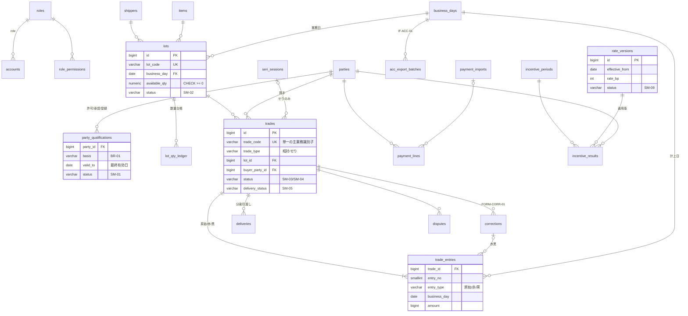

# Database Design — Product A 桜水産市場

> **Kế thừa template** `[###(ProjectID)] ProjectName - Database Design` (No: BM-QT-1701-28, v1.1). Giữ các sheet của template thành các mục: `History of changes` → §1, `Tables List` → §2, `ER Diagram` → §3, `Table_name` (mỗi bảng 1 sheet) → §7; giá trị Status theo sheet `Appendix` (Approved / Decision (provisional) / Modify / Undecided / Cancelled). Thêm mới §4〜§6 (index, lưu trữ, **đối chiếu prototype**) vì template không có.
>
> DDL sinh từ cùng nguồn: [`03_Database-DDL.sql`](03_Database-DDL.sql) — đã chạy thử trên PostgreSQL 16 (29 bảng, 251 cột, không lỗi).

## 1. History of changes

| No | Version | Action | Sheet | Description | Updated Date | Updated by |
|---|---|---|---|---|---|---|
| 1 | 1.0 | Add new | All | Thiết kế DB production từ schema prototype LAB-2 + RFP 08-01 (D-PARTY, D-LOT, D-TRADE, D-DELIVERY, D-SETTLE, D-INCENTIVE) | 2026-11-15 | An (+ Claude) |
| 2 | 1.1 | Modify | incentive_results | Thêm `superseded_at` (再計算 không xóa dòng — PREMISE LAB-5 S-02) | 2026-11-16 | An (+ Claude) |

## 2. Tables list

| No | Schema | Category | 論理名 JP | EN | VN | 物理テーブル名 | Detail | Status | Note |
|---|---|---|---|---|---|---|---|---|---|
| 1 | core | master | アカウント | Account | Tài khoản | `accounts` | 社内利用者。認証はCognito、本表は業務属性 | Modify | Prototype: profiles（auth.users参照）→ Cognito化に伴い改名 |
| 2 | core | master | ロール | Role | Vai trò | `roles` | 8ロール（ADR-008） | Decision (provisional) |  |
| 3 | core | master | ロール権限 | Role permission | Quyền của vai trò | `role_permissions` | ロール×操作の権限マトリクス | Approved |  |
| 4 | core | master | 市場カレンダー | Market calendar | Lịch chợ | `market_calendar` | 休市日管理（ADR-005） | Decision (provisional) | Prototype: なし（GAP-14） |
| 5 | core | master | 品目 | Item | Mặt hàng | `items` | 品目・規格・販売単位（Q-04） | Approved |  |
| 6 | core | master | 荷主・船 | Shipper | Chủ hàng/tàu | `shippers` | 出荷者・漁船 | Approved |  |
| 7 | core | master | コード採番 | Code sequence | Bộ đếm mã | `code_sequences` | 業務コードの日別連番（ADR-012） | Decision (provisional) | Prototype: count(*)+1（GAP-08） |
| 8 | party | master | 参加者 | Party | Người tham gia | `parties` | 卸売業者/仲卸/売買参加者/買出人 | Approved |  |
| 9 | party | master | 参加資格 | Qualification | Tư cách tham gia | `party_qualifications` | 許可/承認/市場登録/取引地点登録（ADR-002） | Modify | Prototype: suspended BOOLEAN のみ、状態遷移なし（GAP-03） |
| 10 | lot | transaction | ロット | Lot | Lô hàng | `lots` | 入荷ロット（SM-02） | Modify |  |
| 11 | lot | transaction | ロット数量台帳 | Lot qty ledger | Sổ số lượng lô | `lot_qty_ledger` | 利用可能数量の増減履歴（BR-03） | Decision (provisional) | Prototype: なし。available_qty を直接加減（GAP-05） |
| 12 | trade | transaction | 取引 | Trade | Giao dịch | `trades` | 相対・せり共通。1取引1行（ADR-001, ADR-004） | Modify | Prototype: entry_kind/adjusts_trade_id/correction_id/amount を持ち赤黒を別取引として保存（GAP-01）→ trade_entries へ移す。下書き状態は廃止（SM-03） |
| 13 | trade | transaction | 取引明細（赤黒台帳） | Trade entry | Bút toán giao dịch | `trade_entries` | 原始・赤・黒の明細。金額・照合・会計連携の正本（ADR-004） | Decision (provisional) |  |
| 14 | trade | transaction | せりセッション | Seri session | Phiên せり | `seri_sessions` | せり予定と対象ロット（SCR-050） | Decision (provisional) | Prototype: なし |
| 15 | delivery | transaction | 引渡し | Delivery | Giao hàng | `deliveries` | 分割引渡し・例外（SM-05） | Modify | Prototype: 資格確認・解消者なし（GAP-12） |
| 16 | settle | transaction | 紛争 | Dispute | Tranh chấp | `disputes` | 差異・紛争（SCR-071） | Decision (provisional) | Prototype: なし |
| 17 | settle | transaction | 業務日 | Business day | Ngày nghiệp vụ | `business_days` | 締め状態（SM-06） | Modify | Prototype: locked BOOLEAN のみ（GAP-11） |
| 18 | settle | transaction | 修正依頼 | Correction | Yêu cầu sửa | `corrections` | FORM-CORR-01（SM-07） | Modify | Prototype: 証拠はメモ文字列（GAP-06）、1取引1回まで（GAP-16） |
| 19 | incentive | master | 料率版 | Rate version | Bản料率 | `rate_versions` | 完納奨励金の規程版（ADR-006, SM-09） | Modify | Prototype: 状態3種、年4回チェックなし（GAP-09） |
| 20 | incentive | transaction | 入金取込 | Payment import | Lần nhập thanh toán | `payment_imports` | 会計CSV取込の単位（ADR-009） | Decision (provisional) |  |
| 21 | incentive | transaction | 入金明細 | Payment line | Dòng thanh toán | `payment_lines` | 参加者×期の請求額・入金額・入金日 | Modify | Prototype: payments（請求額なし、手入力のみ）（GAP-07） |
| 22 | incentive | transaction | 奨励金期 | Incentive period | Kỳ 奨励金 | `incentive_periods` | 期の計算・確定状態（SM-08） | Decision (provisional) | Prototype: なし（初回/再計算を既存行の有無で判定）（GAP-07） |
| 23 | incentive | transaction | 奨励金結果 | Incentive result | Kết quả 奨励金 | `incentive_results` | 参加者×期の計算結果と次期差分 | Modify |  |
| 24 | acc | transaction | 会計連携バッチ | Accounting export batch | Lô xuất kế toán | `acc_export_batches` | IF-ACC-01 出力履歴（ADR-009） | Decision (provisional) | Prototype: なし（GAP-13） |
| 25 | core | transaction | 添付ファイル | Attachment | Tệp đính kèm | `attachments` | 証憑・画像（TBL-ATTACH-01） | Decision (provisional) | Prototype: なし |
| 26 | core | transaction | 通知 | Notification | Thông báo | `notifications` | アウトボックス（ADR-011） | Decision (provisional) | Prototype: なし |
| 27 | core | transaction | 監査ログ | Audit log | Nhật ký kiểm toán | `audit_logs` | 追記型。年別パーティション | Approved | Prototype と同等。ただし書込みは業務関数内に統一（GAP-04） |
| 28 | core | transaction | 同期受付 | Sync submission | Bản ghi đồng bộ | `sync_submissions` | オフライン送信の冪等性と競合（ADR-007） | Decision (provisional) | Prototype: なし |
| 29 | core | transaction | ジョブ実行 | Job run | Lần chạy job | `job_runs` | BAT-01〜06 の実行記録 | Decision (provisional) | Prototype: なし |

Status theo sheet `Appendix` của template: **Approved** = giữ như prototype · **Modify** = có ở prototype, thiết kế thay đổi · **Decision (provisional)** = bảng mới, chờ duyệt ở 基本設計 (G2).


## 3. ER Diagram

Chỉ vẽ khóa và quan hệ; cột đầy đủ ở §7. Nhóm theo 6 miền dữ liệu bắt buộc của RFP 08-01.



Bảng không vẽ quan hệ (dùng chung): `market_calendar`, `code_sequences`, `attachments` (đa hình theo `entity`), `notifications`, `audit_logs`, `sync_submissions`, `job_runs`.

### 3.1 Ma trận quyền mặc định

`role_permissions` (seed). ○ = có quyền. Phân tách maker≠checker còn được kiểm tra ở từng bản ghi (BR-12).

| Permission | INTAKE | JUDGE | TRADE | DELIVERY | SETTLEMENT | APPROVER | RULE-ADMIN | SYS-ADMIN |
|---|---|---|---|---|---|---|---|---|
| lot.write (受付・販売準備) | ○ | | | | | | | |
| lot.judge (目利き記録) | | ○ | | | | | | |
| lot.publish (公開) | | | ○ | | | | | |
| lot.adjust (属性調整) | | | | | ○ | | | |
| trade.write (相対 確定・取消) | | | ○ | | | | | |
| seri.write (せり結果入力) | | | ○ | | | | | |
| seri.approve (せり確認) | | | ○ | | | ○ | | |
| delivery.write | | | | ○ | | | | |
| delivery.resolve (例外解消) | | | | | ○ | | | |
| party.write (参加者・資格申請) | | | | | ○ | | | |
| party.approve (資格承認・解除・失効) | | | | | | ○ | | |
| settle.lock / settle.reopen.request | | | | | ○ | | | |
| settle.reopen.approve / settle.publish | | | | | | ○ | | |
| correction.request | | | ○ | | ○ | | | |
| correction.approve | | | | | | ○ | | |
| payment.import / incentive.run | | | | | ○ | | | |
| incentive.close (期確定) | | | | | | ○ | | |
| rate.draft / rate.rollback | | | | | | | ○ | |
| rate.approve | | | | | | ○ | | |
| report.export | | | | | ○ | ○ | | ○ |
| audit.read | | | | | ○ | ○ | | ○ |
| admin.users / admin.roles / master.write | | | | | | | | ○ |

Khác prototype: INTAKE mất `lot.judge` (GAP-02); SYS-ADMIN không còn quyền nghiệp vụ (ADR-008); thêm 8 permission mới.

## 4. Index và hiệu năng (NFR-PERF-01: p95 ≤ 2s)

| Truy vấn chính | Index | Màn hình |
|---|---|---|
| Giao dịch theo ngày (đối chiếu, báo cáo) | `trades_day_idx`, `te_day_idx` | SCR-041, SCR-070, RPT-01 |
| Lịch sử theo người tham gia | `trades_buyer_idx (buyer_party_id, business_day)` | SCR-021 tab 取引履歴 |
| Tìm theo mã | unique `trade_code`, `lot_code`, `correction_code` | mọi màn hình chi tiết, OBJ-02 (≤ 2 phút tìm hồ sơ) |
| Kiểm tra tư cách | `pq_party_basis_idx (party_id, basis, valid_to)` | DD-01 (gọi mỗi lần xác nhận) |
| Audit theo đối tượng / ngày | `audit_entity_idx`, `audit_day_idx` | SCR-140 (FR-AUDIT-02) |
| Lô của ngày theo trạng thái | `lots_day_status_idx` | SCR-031, SCR-040 (chọn lô) |

Khóa: chỉ `SELECT … FOR UPDATE` trên **1 dòng `lots`** và **1 dòng `trades`**; không khóa bảng. 60 người đồng thời tranh nhau cùng 1 lô là hiếm (1 lô thường 1〜3 người mua).

## 5. Lưu trữ và partition (DR-RET-01, TBL-ATTACH-01, B.7)

| Dữ liệu | Thời hạn | Cách làm |
|---|---|---|
| `trades`, `trade_entries`, `deliveries`, `audit_logs` | 7 năm online | Partition RANGE theo năm (`business_day`); partition > 7 năm detach → export S3 Glacier, xóa vật lý cần duyệt (BR-16) |
| `attachments` (ảnh, phiếu) | 3 năm chuẩn → cold | S3 lifecycle → Glacier Flexible Retrieval (khôi phục ≤ 12h < 2 ngày); `storage_class` cập nhật bởi BAT-06 |
| `notifications`, `job_runs`, `sync_submissions` | 13 tháng | Xóa theo batch hằng tháng (dữ liệu vận hành, không phải hồ sơ nghiệp vụ) |
| Dữ liệu migration | 13 tháng gần nhất (Q-15) | Wave 2; dữ liệu cũ hơn chỉ PDF tham chiếu |

## 6. Đối chiếu với prototype LAB-2

### 6.1 Cách đối chiếu

1. Nạp `supabase/schema-tables.sql` của repo LAB-2 vào PostgreSQL 16 cục bộ (giả lập `auth.users`) và nạp DDL thiết kế vào DB khác.
2. So `information_schema.columns` từng bảng bằng script (kết quả §6.2).
3. Đọc các hàm `schema-functions*.sql` và 25 API route để tìm khác biệt về **hành vi** (§6.3) — phần mà so cột không thấy.

Giới hạn: không truy vấn trực tiếp DB Supabase đang chạy (không dùng secret production trong LAB-4). `npm run db:setup` tạo DB từ đúng các file SQL này nên schema trùng khớp; trước LAB-5 nên chạy câu SQL ở §6.4 trên Supabase để chắc chắn không có thay đổi tay.

### 6.2 Khác biệt cột (kết quả script)

| Bảng prototype → thiết kế | Chỉ có ở prototype | Chỉ có ở thiết kế |
|---|---|---|
| profiles → `accounts` | `active` (→ `status`) | `status`, `employee_no`, `mfa_required`, `acting_approver_until` |
| party_qualifications | `suspended`, `note` (→ `status`, `status_reason`) | `status`, `status_reason`, `approved_by`, `created_by` |
| lots | — | `client_uuid` |
| trades | `entry_kind`, `adjusts_trade_id`, `correction_id`, `amount` (→ `trade_entries`) | `reject_reason`, `seri_session_id` |
| deliveries | — | `resolved_by`, `resolved_at`, `device_time`, `client_uuid` |
| business_days | `locked` (→ `status`) | `status`, `reopen_reason`, `reopen_requested_by` |
| corrections | `evidence_note` (→ `attachments`) | `target_business_day`, `affects_settlement` |
| rate_versions | `note` (→ `change_reason`) | `change_reason`, `rollback_reason` |
| payments → `payment_lines` | `recorded_by/at` (→ `created_by/at`) | `billed_amount`, `import_id`, `manual_reason` |
| incentive_results | `paid_amount` (→ `paid_by_due`) | `paid_by_due` |
| audit_logs | — | `business_day` |
| items, shippers, parties, role_permissions | (trùng) | `parties.limit_amount` |
| — | — | 14 bảng mới: `roles`, `market_calendar`, `code_sequences`, `lot_qty_ledger`, `trade_entries`, `seri_sessions`, `disputes`, `payment_imports`, `incentive_periods`, `acc_export_batches`, `attachments`, `notifications`, `sync_submissions`, `job_runs` |

Ba cột prototype có mà bản thiết kế đầu tiên bỏ sót — script phát hiện và đã thêm lại vào thiết kế: `audit_logs.actor_email` (giữ được người làm khi tài khoản bị xóa), `incentive_results.last_paid_on`, `rate_versions.rolled_back_at`.

### 6.3 Chỗ prototype làm khác thiết kế (GAP list → input task LAB-5)

| GAP | Prototype LAB-2 (file) | Thiết kế | Mức | Căn cứ |
|---|---|---|---|---|
| GAP-01 | 赤黒 tạo 2 giao dịch mới mã `-R{id}`/`-C{id}` trong `trades` (`schema-functions-corrections.sql`) | Dòng `trade_entries` dưới cùng `trade_code` | Cao | 06-04, ADR-004 |
| GAP-02 | ROLE-INTAKE được ghi 目利き; không có trạng thái `販売準備`; ghi lại đánh giá không cần lý do (`api/lots/[id]`) | Chỉ ROLE-JUDGE; SM-02 đủ 6 trạng thái; sửa đánh giá cần lý do | TB | TBL-ROLE-01, FIG-011 |
| GAP-03 | Tư cách chỉ có cờ `suspended`; không có 申請/失効/再審査; quy tắc lặp ở TS (`party-qualification-status.ts`) và SQL | SM-01; một hàm `fn_check_eligibility` | Cao | FIG-010, ADR-002 |
| GAP-04 | Lô, 目利き, 資格, 料率, 奨励金 ghi từ API route, audit gọi **sau** ở lệnh riêng (`audit-and-business-day.ts`) | Ghi + audit trong 1 hàm DB | Cao | FR-AUDIT-01, ADR-003 |
| GAP-05 | `available_qty` cộng/trừ trực tiếp, không có lịch sử điều chỉnh | Sổ `lot_qty_ledger` | TB | BR-LOT-02 ("調整履歴まで追跡") |
| GAP-06 | Chứng cứ sửa chỉ là ghi chú text | `attachments` (S3) bắt buộc khi ảnh hưởng quyết toán | TB | D.4 |
| GAP-07 | 奨励金: số phải trả tự tính `適格×108/100`; thanh toán nhập tay; lần đầu/lần sau phân biệt bằng "đã có dòng kết quả"; tính ở API route, không khóa | `billed_amount` từ kế toán; `incentive_periods` có khóa kỳ; hàm DB | Cao | BR-INC-01, FR-INC-03, A4-04/06 |
| GAP-08 | Mã lô/giao dịch = `count(*)+1` → trùng khi đăng ký đồng thời | `code_sequences` | TB | DQ-01, ADR-012 |
| GAP-09 | 料率: không kiểm tra 4 lần/năm; thiếu `承認待ち/発効予定/有効/失効`; số bản = max+1 (race) | SM-09, kiểm tra năm tài chính | TB | GOV-RULE-01, ADR-006 |
| GAP-10 | せり không có `差戻し`; bất kỳ ai có `seri.approve` (kể cả SYS-ADMIN) xác nhận được | SM-04 có 差戻し; SYS-ADMIN không có quyền nghiệp vụ | Thấp | FIG-012 |
| GAP-11 | Ngày chỉ có `locked`; không có xin mở lại, không có 公開 | SM-06 | TB | FR-SETTLE-02, 02-08 |
| GAP-12 | Giao hàng không kiểm tra lại tư cách; ngoại lệ không có người xác nhận giải quyết | BR-15, `resolved_by` | TB | FIG-014, CAP-HUMAN-01 |
| GAP-13 | IF-ACC-01 là nút tải CSV, không lưu lịch sử/batch, thuế 8% cứng trong code | `acc_export_batches`, BAT-02, thuế cấu hình | TB | IF-ACC-01, D.2 |
| GAP-14 | Không có lịch chợ (mọi ngày là ngày nghiệp vụ) | `market_calendar` | TB | BASE-03, Q-05 |
| GAP-15 | Supabase region Mumbai, không MFA | AWS Tokyo + Cognito MFA | Cao (production) | ADR-010 |
| GAP-16 | Mỗi giao dịch chỉ sửa được 1 lần | Nhiều lần, đảo bút toán đen gần nhất | Thấp | A4-02 |

Điểm prototype làm **đúng** và thiết kế giữ nguyên: xác nhận 相対 trong 1 transaction có khóa dòng (`fn_create_trade` → `fn_confirm_trade`); trigger chặn sửa ngày đã khóa; audit append-only; revoke `EXECUTE` từ `anon`; `fn_business_day` 02:00 JST; làm tròn xuống bằng số nguyên (bp) trong 奨励金.

### 6.4 SQL kiểm tra trên Supabase trước LAB-5

```sql
-- Cột thực tế của DB đang chạy, so với §6.2
select table_name, string_agg(column_name, ',' order by ordinal_position)
from information_schema.columns where table_schema = 'public' group by 1 order by 1;
-- Hàm nghiệp vụ và quyền thực thi
select p.proname, has_function_privilege('anon', p.oid, 'execute') as anon_exec
from pg_proc p join pg_namespace n on n.oid = p.pronamespace
where n.nspname = 'public' and p.proname like 'fn\_%' order by 1;
```

## 7. Table definitions

Cột `Key`: PK / FK / UQ. `NN` = Not Null (○ Yes / × No). Mọi bảng giao dịch: không có quyền UPDATE/DELETE trực tiếp cho role ứng dụng (ADR-003).

### 7.1 `accounts` — アカウント / Tài khoản

| システム名 | 桜水産市場 業務支援システム | 論理テーブル名 | アカウント |
|---|---|---|---|
| スキーマ名 | core | 物理テーブル名 | `accounts` |
| 文字セット | UTF8 | 概要 | 社内利用者。認証はCognito、本表は業務属性 |

| No. | Key | 論理名 JP | EN | VN | 物理名 | Data Type | Size | NN | Default | Note |
|---|---|---|---|---|---|---|---|---|---|---|
| 1 | PK | アカウントID | account id | ID tài khoản | `id` | UUID |  | ○ |  | Cognito sub と同値 |
| 2 | UQ | メール | email | Email | `email` | VARCHAR | 254 | ○ |  |  |
| 3 |  | 表示名 | display name | Tên hiển thị | `display_name` | VARCHAR | 100 | ○ |  |  |
| 4 |  | 社員番号 | employee no | Mã nhân viên | `employee_no` | VARCHAR | 20 | × |  |  |
| 5 | FK | ロール | role | Vai trò | `role` | VARCHAR | 30 | ○ |  | roles.code |
| 6 |  | 承認代理 | acting approver | Người duyệt thay | `acting_approver_until` | DATE |  | × |  | A4-08。この日まで承認権限 |
| 7 |  | 状態 | status | Trạng thái | `status` | VARCHAR | 10 | ○ | '有効' | 有効/停止/ロック |
| 8 |  | MFA必須 | mfa required | Bắt buộc MFA | `mfa_required` | BOOLEAN |  | ○ | false | ロールから自動設定 |
| 9 |  | 作成日時 | created at | Ngày tạo | `created_at` | TIMESTAMPTZ |  | ○ | now() |  |

**Index:** `accounts_role_idx` (role)

**FK:** `accounts_role_fk`: role → roles.code

### 7.2 `roles` — ロール / Vai trò

| システム名 | 桜水産市場 業務支援システム | 論理テーブル名 | ロール |
|---|---|---|---|
| スキーマ名 | core | 物理テーブル名 | `roles` |
| 文字セット | UTF8 | 概要 | 8ロール（ADR-008） |

| No. | Key | 論理名 JP | EN | VN | 物理名 | Data Type | Size | NN | Default | Note |
|---|---|---|---|---|---|---|---|---|---|---|
| 1 | PK | ロールコード | role code | Mã vai trò | `code` | VARCHAR | 30 | ○ |  | ROLE-INTAKE … |
| 2 |  | 名称 | name | Tên | `name` | VARCHAR | 50 | ○ |  |  |
| 3 |  | MFA必須 | mfa required | Bắt buộc MFA | `mfa_required` | BOOLEAN |  | ○ | false |  |

### 7.3 `role_permissions` — ロール権限 / Quyền của vai trò

| システム名 | 桜水産市場 業務支援システム | 論理テーブル名 | ロール権限 |
|---|---|---|---|
| スキーマ名 | core | 物理テーブル名 | `role_permissions` |
| 文字セット | UTF8 | 概要 | ロール×操作の権限マトリクス |

| No. | Key | 論理名 JP | EN | VN | 物理名 | Data Type | Size | NN | Default | Note |
|---|---|---|---|---|---|---|---|---|---|---|
| 1 | PK | ロール | role | Vai trò | `role` | VARCHAR | 30 | ○ |  |  |
| 2 | PK | 権限 | permission | Quyền | `permission` | VARCHAR | 40 | ○ |  | trade.write など |

**FK:** `role_permissions_role_fk`: role → roles.code

### 7.4 `market_calendar` — 市場カレンダー / Lịch chợ

| システム名 | 桜水産市場 業務支援システム | 論理テーブル名 | 市場カレンダー |
|---|---|---|---|
| スキーマ名 | core | 物理テーブル名 | `market_calendar` |
| 文字セット | UTF8 | 概要 | 休市日管理（ADR-005） |

| No. | Key | 論理名 JP | EN | VN | 物理名 | Data Type | Size | NN | Default | Note |
|---|---|---|---|---|---|---|---|---|---|---|
| 1 | PK | 日付 | day | Ngày | `day` | DATE |  | ○ |  |  |
| 2 |  | 開市 | is open | Mở chợ | `is_open` | BOOLEAN |  | ○ | true |  |
| 3 |  | 備考 | note | Ghi chú | `note` | VARCHAR | 100 | × |  |  |

### 7.5 `items` — 品目 / Mặt hàng

| システム名 | 桜水産市場 業務支援システム | 論理テーブル名 | 品目 |
|---|---|---|---|
| スキーマ名 | core | 物理テーブル名 | `items` |
| 文字セット | UTF8 | 概要 | 品目・規格・販売単位（Q-04） |

| No. | Key | 論理名 JP | EN | VN | 物理名 | Data Type | Size | NN | Default | Note |
|---|---|---|---|---|---|---|---|---|---|---|
| 1 | PK | ID | id | ID | `id` | BIGINT | identity | ○ |  |  |
| 2 | UQ | 品目コード | item code | Mã mặt hàng | `code` | VARCHAR | 10 | ○ |  |  |
| 3 |  | 品目名 | item name | Tên | `name` | VARCHAR | 50 | ○ |  |  |
| 4 |  | 販売単位 | unit | Đơn vị | `unit` | VARCHAR | 5 | ○ |  | kg/箱/尾 |

### 7.6 `shippers` — 荷主・船 / Chủ hàng/tàu

| システム名 | 桜水産市場 業務支援システム | 論理テーブル名 | 荷主・船 |
|---|---|---|---|
| スキーマ名 | core | 物理テーブル名 | `shippers` |
| 文字セット | UTF8 | 概要 | 出荷者・漁船 |

| No. | Key | 論理名 JP | EN | VN | 物理名 | Data Type | Size | NN | Default | Note |
|---|---|---|---|---|---|---|---|---|---|---|
| 1 | PK | ID | id | ID | `id` | BIGINT | identity | ○ |  |  |
| 2 | UQ | 荷主コード | shipper code | Mã chủ hàng | `code` | VARCHAR | 10 | ○ |  |  |
| 3 |  | 名称 | name | Tên | `name` | VARCHAR | 100 | ○ |  |  |

### 7.7 `code_sequences` — コード採番 / Bộ đếm mã

| システム名 | 桜水産市場 業務支援システム | 論理テーブル名 | コード採番 |
|---|---|---|---|
| スキーマ名 | core | 物理テーブル名 | `code_sequences` |
| 文字セット | UTF8 | 概要 | 業務コードの日別連番（ADR-012） |

| No. | Key | 論理名 JP | EN | VN | 物理名 | Data Type | Size | NN | Default | Note |
|---|---|---|---|---|---|---|---|---|---|---|
| 1 | PK | コード種別 | code type | Loại mã | `code_type` | VARCHAR | 10 | ○ |  | LOT/TRD/CR/ACC |
| 2 | PK | 業務日 | business day | Ngày nghiệp vụ | `business_day` | DATE |  | ○ |  |  |
| 3 |  | 最終番号 | last no | Số cuối | `last_no` | INTEGER |  | ○ | 0 |  |

### 7.8 `parties` — 参加者 / Người tham gia

| システム名 | 桜水産市場 業務支援システム | 論理テーブル名 | 参加者 |
|---|---|---|---|
| スキーマ名 | party | 物理テーブル名 | `parties` |
| 文字セット | UTF8 | 概要 | 卸売業者/仲卸/売買参加者/買出人 |

| No. | Key | 論理名 JP | EN | VN | 物理名 | Data Type | Size | NN | Default | Note |
|---|---|---|---|---|---|---|---|---|---|---|
| 1 | PK | ID | id | ID | `id` | BIGINT | identity | ○ |  |  |
| 2 | UQ | 参加者コード | party code | Mã người tham gia | `code` | VARCHAR | 10 | ○ |  |  |
| 3 |  | 名称 | name | Tên | `name` | VARCHAR | 100 | ○ |  |  |
| 4 |  | 参加区分 | party type | Loại | `party_type` | VARCHAR | 10 | ○ |  | CHECK 4区分 |
| 5 |  | メール | email | Email | `email` | VARCHAR | 254 | × |  | 通知用 |
| 6 |  | 参加上限額 | limit amount | Hạn mức | `limit_amount` | BIGINT |  | × |  | Q-18: 表示のみ |
| 7 |  | 作成日時 | created at | Ngày tạo | `created_at` | TIMESTAMPTZ |  | ○ | now() |  |

### 7.9 `party_qualifications` — 参加資格 / Tư cách tham gia

| システム名 | 桜水産市場 業務支援システム | 論理テーブル名 | 参加資格 |
|---|---|---|---|
| スキーマ名 | party | 物理テーブル名 | `party_qualifications` |
| 文字セット | UTF8 | 概要 | 許可/承認/市場登録/取引地点登録（ADR-002） |

| No. | Key | 論理名 JP | EN | VN | 物理名 | Data Type | Size | NN | Default | Note |
|---|---|---|---|---|---|---|---|---|---|---|
| 1 | PK | ID | id | ID | `id` | BIGINT | identity | ○ |  |  |
| 2 | FK | 参加者ID | party id | ID người tham gia | `party_id` | BIGINT |  | ○ |  |  |
| 3 |  | 参加根拠 | basis | Căn cứ | `basis` | VARCHAR | 10 | ○ |  | BR-01: 区分と一致 |
| 4 |  | 証番号 | certificate no | Số giấy phép | `certificate_no` | VARCHAR | 30 | ○ |  |  |
| 5 |  | 有効開始日 | valid from | Hiệu lực từ | `valid_from` | DATE |  | ○ |  |  |
| 6 |  | 最終有効日 | valid to | Ngày hiệu lực cuối | `valid_to` | DATE |  | ○ |  | Q-19 |
| 7 |  | 状態 | status | Trạng thái | `status` | VARCHAR | 10 | ○ | '申請' | SM-01 |
| 8 |  | 状態理由 | status reason | Lý do | `status_reason` | VARCHAR | 200 | × |  |  |
| 9 | FK | 承認者 | approved by | Người duyệt | `approved_by` | UUID |  | × |  | ≠ created_by |
| 10 | FK | 作成者 | created by | Người tạo | `created_by` | UUID |  | ○ |  | accounts.id |
| 11 |  | 作成日時 | created at | Ngày tạo | `created_at` | TIMESTAMPTZ |  | ○ | now() |  |

**Index:** `pq_party_basis_idx` (party_id, basis, valid_to)

**FK:** `pq_party_fk`: party_id → parties.id

### 7.10 `lots` — ロット / Lô hàng

| システム名 | 桜水産市場 業務支援システム | 論理テーブル名 | ロット |
|---|---|---|---|
| スキーマ名 | lot | 物理テーブル名 | `lots` |
| 文字セット | UTF8 | 概要 | 入荷ロット（SM-02） |

| No. | Key | 論理名 JP | EN | VN | 物理名 | Data Type | Size | NN | Default | Note |
|---|---|---|---|---|---|---|---|---|---|---|
| 1 | PK | ID | id | ID | `id` | BIGINT | identity | ○ |  |  |
| 2 | UQ | ロットコード | lot code | Mã lô | `lot_code` | VARCHAR | 12 | ○ |  | L{YYMMDD}-{000} |
| 3 | FK | 業務日 | business day | Ngày nghiệp vụ | `business_day` | DATE |  | ○ |  |  |
| 4 | FK | 荷主ID | shipper id | ID chủ hàng | `shipper_id` | BIGINT |  | ○ |  |  |
| 5 | FK | 品目ID | item id | ID mặt hàng | `item_id` | BIGINT |  | ○ |  |  |
| 6 |  | 初期数量 | initial qty | Số lượng ban đầu | `initial_qty` | NUMERIC | 10,1 | ○ |  | > 0 |
| 7 |  | 利用可能数量 | available qty | Số lượng khả dụng | `available_qty` | NUMERIC | 10,1 | ○ |  | CHECK >= 0（BR-03） |
| 8 |  | 状態 | status | Trạng thái | `status` | VARCHAR | 10 | ○ | '受付' | SM-02（販売準備を追加） |
| 9 |  | 評価結果 | judge result | Kết quả đánh giá | `judge_result` | VARCHAR | 10 | × |  | 人が選択（BR-11） |
| 10 | FK | 評価者 | judged by | Người đánh giá | `judged_by` | UUID |  | × |  | ROLE-JUDGE |
| 11 |  | 評価時刻 | judged at | Thời điểm đánh giá | `judged_at` | TIMESTAMPTZ |  | × |  |  |
| 12 | UQ | 端末送信ID | client uuid | Idempotency key | `client_uuid` | UUID |  | × |  | オフライン重複防止 |
| 13 | FK | 作成者 | created by | Người tạo | `created_by` | UUID |  | ○ |  | accounts.id |
| 14 |  | 作成日時 | created at | Ngày tạo | `created_at` | TIMESTAMPTZ |  | ○ | now() |  |

**Index:** `lots_day_status_idx` (business_day, status)

**FK:** `lots_shipper_fk`: shipper_id → shippers.id; `lots_item_fk`: item_id → items.id

### 7.11 `lot_qty_ledger` — ロット数量台帳 / Sổ số lượng lô

| システム名 | 桜水産市場 業務支援システム | 論理テーブル名 | ロット数量台帳 |
|---|---|---|---|
| スキーマ名 | lot | 物理テーブル名 | `lot_qty_ledger` |
| 文字セット | UTF8 | 概要 | 利用可能数量の増減履歴（BR-03） |

| No. | Key | 論理名 JP | EN | VN | 物理名 | Data Type | Size | NN | Default | Note |
|---|---|---|---|---|---|---|---|---|---|---|
| 1 | PK | ID | id | ID | `id` | BIGINT | identity | ○ |  |  |
| 2 | FK | ロットID | lot id | ID lô | `lot_id` | BIGINT |  | ○ |  |  |
| 3 |  | 増減 | delta | Tăng/giảm | `delta` | NUMERIC | 10,1 | ○ |  |  |
| 4 |  | 事由 | reason type | Loại lý do | `reason_type` | VARCHAR | 10 | ○ |  | 受付/確定/取消/赤黒/調整 |
| 5 | FK | 取引ID | trade id | ID giao dịch | `trade_id` | BIGINT |  | × |  |  |
| 6 |  | 理由 | reason | Lý do | `reason` | VARCHAR | 200 | × |  | 調整時必須 |
| 7 | FK | 作成者 | created by | Người tạo | `created_by` | UUID |  | ○ |  | accounts.id |
| 8 |  | 作成日時 | created at | Ngày tạo | `created_at` | TIMESTAMPTZ |  | ○ | now() |  |

**FK:** `lql_lot_fk`: lot_id → lots.id

### 7.12 `trades` — 取引 / Giao dịch

| システム名 | 桜水産市場 業務支援システム | 論理テーブル名 | 取引 |
|---|---|---|---|
| スキーマ名 | trade | 物理テーブル名 | `trades` |
| 文字セット | UTF8 | 概要 | 相対・せり共通。1取引1行（ADR-001, ADR-004） |

| No. | Key | 論理名 JP | EN | VN | 物理名 | Data Type | Size | NN | Default | Note |
|---|---|---|---|---|---|---|---|---|---|---|
| 1 | PK | ID | id | ID | `id` | BIGINT | identity | ○ |  |  |
| 2 | UQ | 取引コード | trade code | Mã giao dịch | `trade_code` | VARCHAR | 12 | ○ |  | T{YYMMDD}-{0000} |
| 3 |  | 取引種別 | trade type | Loại giao dịch | `trade_type` | VARCHAR | 4 | ○ |  | 相対/せり |
| 4 | FK | 業務日 | business day | Ngày nghiệp vụ | `business_day` | DATE |  | ○ |  |  |
| 5 | FK | ロットID | lot id | ID lô | `lot_id` | BIGINT |  | ○ |  |  |
| 6 | FK | 買手ID | buyer party id | ID người mua | `buyer_party_id` | BIGINT |  | ○ |  |  |
| 7 |  | 数量（原始） | qty | Số lượng gốc | `qty` | NUMERIC | 10,1 | ○ |  | > 0 |
| 8 |  | 単価（原始） | unit price | Đơn giá gốc | `unit_price` | INTEGER |  | ○ |  | >= 0 円 |
| 9 |  | 状態 | status | Trạng thái | `status` | VARCHAR | 6 | ○ |  | 確認待ち/差戻し/確定/取消 |
| 10 |  | 引渡し状態 | delivery status | Trạng thái giao | `delivery_status` | VARCHAR | 6 | ○ | '対象外' | SM-05 |
| 11 |  | せり時刻 | seri time | Giờ せり | `seri_time` | TIME |  | × |  | せりのみ |
| 12 | FK | せりセッション | seri session | Phiên せり | `seri_session_id` | BIGINT |  | × |  | SCR-050 |
| 13 |  | 取消理由 | cancel reason | Lý do hủy | `cancel_reason` | VARCHAR | 200 | × |  |  |
| 14 |  | 差戻し理由 | reject reason | Lý do trả lại | `reject_reason` | VARCHAR | 200 | × |  |  |
| 15 | FK | 作成者 | created by | Người tạo | `created_by` | UUID |  | ○ |  | accounts.id |
| 16 |  | 作成日時 | created at | Ngày tạo | `created_at` | TIMESTAMPTZ |  | ○ | now() |  |
| 17 | FK | 確定者 | confirmed by | Người xác nhận | `confirmed_by` | UUID |  | × |  | せり: ≠ created_by |
| 18 |  | 確定時刻 | confirmed at | Thời điểm xác nhận | `confirmed_at` | TIMESTAMPTZ |  | × |  |  |

**Index:** `trades_day_idx` (business_day); `trades_buyer_idx` (buyer_party_id, business_day); `trades_lot_idx` (lot_id)

**FK:** `trades_lot_fk`: lot_id → lots.id; `trades_buyer_fk`: buyer_party_id → parties.id

### 7.13 `trade_entries` — 取引明細（赤黒台帳） / Bút toán giao dịch

| システム名 | 桜水産市場 業務支援システム | 論理テーブル名 | 取引明細（赤黒台帳） |
|---|---|---|---|
| スキーマ名 | trade | 物理テーブル名 | `trade_entries` |
| 文字セット | UTF8 | 概要 | 原始・赤・黒の明細。金額・照合・会計連携の正本（ADR-004） |

| No. | Key | 論理名 JP | EN | VN | 物理名 | Data Type | Size | NN | Default | Note |
|---|---|---|---|---|---|---|---|---|---|---|
| 1 | PK | ID | id | ID | `id` | BIGINT | identity | ○ |  |  |
| 2 | FK | 取引ID | trade id | ID giao dịch | `trade_id` | BIGINT |  | ○ |  |  |
| 3 |  | 明細番号 | entry no | Số bút toán | `entry_no` | SMALLINT |  | ○ |  | 1=原始 |
| 4 |  | 明細種別 | entry type | Loại bút toán | `entry_type` | VARCHAR | 2 | ○ |  | 原始/赤/黒 |
| 5 | FK | 計上業務日 | business day | Ngày ghi sổ | `business_day` | DATE |  | ○ |  | 赤黒は修正承認日 |
| 6 |  | 数量 | qty | Số lượng | `qty` | NUMERIC | 10,1 | ○ |  | 赤は負 |
| 7 |  | 単価 | unit price | Đơn giá | `unit_price` | INTEGER |  | ○ |  |  |
| 8 |  | 金額 | amount | Thành tiền | `amount` | BIGINT |  | ○ |  | floor(qty×unit_price) |
| 9 | FK | 修正依頼ID | correction id | ID yêu cầu sửa | `correction_id` | BIGINT |  | × |  | 赤黒のみ |
| 10 | FK | 取消対象明細 | reverses entry | Bút toán bị đảo | `reverses_entry_no` | SMALLINT |  | × |  | 赤のみ |
| 11 | FK | 作成者 | created by | Người tạo | `created_by` | UUID |  | ○ |  | accounts.id |
| 12 |  | 作成日時 | created at | Ngày tạo | `created_at` | TIMESTAMPTZ |  | ○ | now() |  |

**Index:** `te_trade_entry_uq` (trade_id, entry_no) UNIQUE; `te_day_idx` (business_day)

**FK:** `te_trade_fk`: trade_id → trades.id; `te_corr_fk`: correction_id → corrections.id

### 7.14 `seri_sessions` — せりセッション / Phiên せり

| システム名 | 桜水産市場 業務支援システム | 論理テーブル名 | せりセッション |
|---|---|---|---|
| スキーマ名 | trade | 物理テーブル名 | `seri_sessions` |
| 文字セット | UTF8 | 概要 | せり予定と対象ロット（SCR-050） |

| No. | Key | 論理名 JP | EN | VN | 物理名 | Data Type | Size | NN | Default | Note |
|---|---|---|---|---|---|---|---|---|---|---|
| 1 | PK | ID | id | ID | `id` | BIGINT | identity | ○ |  |  |
| 2 | FK | 業務日 | business day | Ngày nghiệp vụ | `business_day` | DATE |  | ○ |  |  |
| 3 |  | 開始予定 | starts at | Giờ bắt đầu | `starts_at` | TIME |  | ○ |  |  |
| 4 |  | 場所 | place | Vị trí | `place` | VARCHAR | 30 | × |  |  |
| 5 | FK | 作成者 | created by | Người tạo | `created_by` | UUID |  | ○ |  | accounts.id |
| 6 |  | 作成日時 | created at | Ngày tạo | `created_at` | TIMESTAMPTZ |  | ○ | now() |  |

### 7.15 `deliveries` — 引渡し / Giao hàng

| システム名 | 桜水産市場 業務支援システム | 論理テーブル名 | 引渡し |
|---|---|---|---|
| スキーマ名 | delivery | 物理テーブル名 | `deliveries` |
| 文字セット | UTF8 | 概要 | 分割引渡し・例外（SM-05） |

| No. | Key | 論理名 JP | EN | VN | 物理名 | Data Type | Size | NN | Default | Note |
|---|---|---|---|---|---|---|---|---|---|---|
| 1 | PK | ID | id | ID | `id` | BIGINT | identity | ○ |  |  |
| 2 | FK | 取引ID | trade id | ID giao dịch | `trade_id` | BIGINT |  | ○ |  |  |
| 3 |  | 回次 | seq | Lần | `seq` | SMALLINT |  | ○ |  |  |
| 4 |  | 数量 | qty | Số lượng | `qty` | NUMERIC | 10,1 | ○ |  | >= 0 |
| 5 |  | 例外種別 | exception type | Loại ngoại lệ | `exception_type` | VARCHAR | 8 | × |  | 不足/超過/返却/部分キャンセル/資格確認 |
| 6 |  | 理由 | reason | Lý do | `reason` | VARCHAR | 200 | × |  | 例外時必須 |
| 7 |  | 解消者 | resolved by | Người xác nhận | `resolved_by` | UUID |  | × |  | ≠ recorded_by（BR-11） |
| 8 |  | 解消時刻 | resolved at | Thời điểm xác nhận | `resolved_at` | TIMESTAMPTZ |  | × |  |  |
| 9 |  | 端末時刻 | device time | Giờ thiết bị | `device_time` | TIMESTAMPTZ |  | × |  | オフライン |
| 10 | UQ | 端末送信ID | client uuid | Idempotency key | `client_uuid` | UUID |  | × |  |  |
| 11 | FK | 記録者 | recorded by | Người ghi | `recorded_by` | UUID |  | ○ |  |  |
| 12 |  | 記録時刻 | recorded at | Thời điểm ghi | `recorded_at` | TIMESTAMPTZ |  | ○ | now() |  |

**Index:** `deliveries_trade_seq_uq` (trade_id, seq) UNIQUE

**FK:** `deliveries_trade_fk`: trade_id → trades.id

### 7.16 `disputes` — 紛争 / Tranh chấp

| システム名 | 桜水産市場 業務支援システム | 論理テーブル名 | 紛争 |
|---|---|---|---|
| スキーマ名 | settle | 物理テーブル名 | `disputes` |
| 文字セット | UTF8 | 概要 | 差異・紛争（SCR-071） |

| No. | Key | 論理名 JP | EN | VN | 物理名 | Data Type | Size | NN | Default | Note |
|---|---|---|---|---|---|---|---|---|---|---|
| 1 | PK | ID | id | ID | `id` | BIGINT | identity | ○ |  |  |
| 2 | FK | 取引ID | trade id | ID giao dịch | `trade_id` | BIGINT |  | ○ |  |  |
| 3 |  | 状態 | status | Trạng thái | `status` | VARCHAR | 6 | ○ | '対応中' | 対応中/解決/取下げ |
| 4 |  | 原因 | cause | Nguyên nhân | `cause` | VARCHAR | 200 | ○ |  |  |
| 5 | FK | 担当者 | owner | Người phụ trách | `owner_id` | UUID |  | ○ |  |  |
| 6 |  | 予定日 | due date | Ngày dự kiến | `due_date` | DATE |  | × |  |  |
| 7 |  | 結果 | result | Kết quả | `result` | VARCHAR | 200 | × |  |  |
| 8 | FK | 作成者 | created by | Người tạo | `created_by` | UUID |  | ○ |  | accounts.id |
| 9 |  | 作成日時 | created at | Ngày tạo | `created_at` | TIMESTAMPTZ |  | ○ | now() |  |

### 7.17 `business_days` — 業務日 / Ngày nghiệp vụ

| システム名 | 桜水産市場 業務支援システム | 論理テーブル名 | 業務日 |
|---|---|---|---|
| スキーマ名 | settle | 物理テーブル名 | `business_days` |
| 文字セット | UTF8 | 概要 | 締め状態（SM-06） |

| No. | Key | 論理名 JP | EN | VN | 物理名 | Data Type | Size | NN | Default | Note |
|---|---|---|---|---|---|---|---|---|---|---|
| 1 | PK | 業務日 | day | Ngày | `day` | DATE |  | ○ |  |  |
| 2 |  | 状態 | status | Trạng thái | `status` | VARCHAR | 8 | ○ | '営業中' | 営業中/ロック済/再開申請中/公開済 |
| 3 | FK | ロック者 | locked by | Người khóa | `locked_by` | UUID |  | × |  |  |
| 4 |  | ロック時刻 | locked at | Thời điểm khóa | `locked_at` | TIMESTAMPTZ |  | × |  |  |
| 5 |  | 再開申請理由 | reopen reason | Lý do mở lại | `reopen_reason` | VARCHAR | 200 | × |  |  |
| 6 | FK | 再開申請者 | reopen requested by | Người xin mở | `reopen_requested_by` | UUID |  | × |  |  |

### 7.18 `corrections` — 修正依頼 / Yêu cầu sửa

| システム名 | 桜水産市場 業務支援システム | 論理テーブル名 | 修正依頼 |
|---|---|---|---|
| スキーマ名 | settle | 物理テーブル名 | `corrections` |
| 文字セット | UTF8 | 概要 | FORM-CORR-01（SM-07） |

| No. | Key | 論理名 JP | EN | VN | 物理名 | Data Type | Size | NN | Default | Note |
|---|---|---|---|---|---|---|---|---|---|---|
| 1 | PK | ID | id | ID | `id` | BIGINT | identity | ○ |  |  |
| 2 | UQ | 修正依頼コード | correction code | Mã yêu cầu | `correction_code` | VARCHAR | 14 | ○ |  | CR-{YYYY}-{00000} |
| 3 | FK | 取引ID | trade id | ID giao dịch | `trade_id` | BIGINT |  | ○ |  |  |
| 4 |  | 対象業務日 | target day | Ngày bị sửa | `target_business_day` | DATE |  | ○ |  |  |
| 5 |  | 新数量 | new qty | Số lượng mới | `new_qty` | NUMERIC | 10,1 | ○ |  |  |
| 6 |  | 新単価 | new unit price | Đơn giá mới | `new_unit_price` | INTEGER |  | ○ |  |  |
| 7 |  | 理由 | reason | Lý do | `reason` | VARCHAR | 500 | ○ |  |  |
| 8 |  | 精算・引渡し影響 | affects settlement | Ảnh hưởng quyết toán | `affects_settlement` | BOOLEAN |  | ○ |  | true なら証拠添付必須 |
| 9 |  | 状態 | status | Trạng thái | `status` | VARCHAR | 8 | ○ | '承認待ち' | SM-07 |
| 10 | FK | 申請者 | requested by | Người yêu cầu | `requested_by` | UUID |  | ○ |  |  |
| 11 |  | 申請時刻 | requested at | Thời điểm yêu cầu | `requested_at` | TIMESTAMPTZ |  | ○ | now() |  |
| 12 | FK | 審査者 | reviewed by | Người duyệt | `reviewed_by` | UUID |  | × |  | ≠ requested_by |
| 13 |  | 審査時刻 | reviewed at | Thời điểm duyệt | `reviewed_at` | TIMESTAMPTZ |  | × |  |  |
| 14 |  | 審査コメント | review comment | Nhận xét | `review_comment` | VARCHAR | 500 | × |  | 却下・追加情報要求で必須 |

**FK:** `corrections_trade_fk`: trade_id → trades.id

### 7.19 `rate_versions` — 料率版 / Bản料率

| システム名 | 桜水産市場 業務支援システム | 論理テーブル名 | 料率版 |
|---|---|---|---|
| スキーマ名 | incentive | 物理テーブル名 | `rate_versions` |
| 文字セット | UTF8 | 概要 | 完納奨励金の規程版（ADR-006, SM-09） |

| No. | Key | 論理名 JP | EN | VN | 物理名 | Data Type | Size | NN | Default | Note |
|---|---|---|---|---|---|---|---|---|---|---|
| 1 | PK | ID | id | ID | `id` | BIGINT | identity | ○ |  |  |
| 2 | UQ | 版番号 | version no | Số bản | `version_no` | INTEGER |  | ○ |  |  |
| 3 |  | 発効日 | effective from | Ngày hiệu lực | `effective_from` | DATE |  | ○ |  | > 起票時の業務日 |
| 4 |  | 交付率(bp) | rate bp | Tỉ lệ (bp) | `rate_bp` | INTEGER |  | ○ |  | 0〜10000 |
| 5 |  | 最低閾値 | threshold amount | Ngưỡng | `threshold_amount` | BIGINT |  | ○ | 0 | 以上で対象 |
| 6 |  | 税係数 分子 | tax numerator | Tử số thuế | `tax_numerator` | SMALLINT |  | ○ | 110 | Q-06 |
| 7 |  | 税係数 分母 | tax denominator | Mẫu số thuế | `tax_denominator` | SMALLINT |  | ○ | 100 |  |
| 8 |  | 支払日数 | payment due days | Số ngày hạn | `payment_due_days` | SMALLINT |  | ○ |  | 期末+N日（当日含む） |
| 9 |  | 状態 | status | Trạng thái | `status` | VARCHAR | 8 | ○ | '草案' | SM-09 |
| 10 |  | 変更理由 | change reason | Lý do thay đổi | `change_reason` | VARCHAR | 500 | ○ |  |  |
| 11 | FK | 作成者 | created by | Người tạo | `created_by` | UUID |  | ○ |  | accounts.id |
| 12 |  | 作成日時 | created at | Ngày tạo | `created_at` | TIMESTAMPTZ |  | ○ | now() |  |
| 13 | FK | 承認者 | approved by | Người duyệt | `approved_by` | UUID |  | × |  | ≠ created_by |
| 14 |  | 承認時刻 | approved at | Thời điểm duyệt | `approved_at` | TIMESTAMPTZ |  | × |  |  |
| 15 | FK | ロールバック者 | rolled back by | Người rollback | `rolled_back_by` | UUID |  | × |  |  |
| 16 |  | ロールバック時刻 | rolled back at | Thời điểm rollback | `rolled_back_at` | TIMESTAMPTZ |  | × |  |  |
| 17 |  | ロールバック理由 | rollback reason | Lý do rollback | `rollback_reason` | VARCHAR | 500 | × |  |  |

### 7.20 `payment_imports` — 入金取込 / Lần nhập thanh toán

| システム名 | 桜水産市場 業務支援システム | 論理テーブル名 | 入金取込 |
|---|---|---|---|
| スキーマ名 | incentive | 物理テーブル名 | `payment_imports` |
| 文字セット | UTF8 | 概要 | 会計CSV取込の単位（ADR-009） |

| No. | Key | 論理名 JP | EN | VN | 物理名 | Data Type | Size | NN | Default | Note |
|---|---|---|---|---|---|---|---|---|---|---|
| 1 | PK | ID | id | ID | `id` | BIGINT | identity | ○ |  |  |
| 2 |  | ファイル名 | file name | Tên file | `file_name` | VARCHAR | 200 | ○ |  |  |
| 3 |  | S3キー | s3 key | Khóa S3 | `s3_key` | VARCHAR | 300 | ○ |  |  |
| 4 |  | 件数 | row count | Số dòng | `row_count` | INTEGER |  | ○ |  |  |
| 5 |  | 状態 | status | Trạng thái | `status` | VARCHAR | 6 | ○ |  | 取込済/エラー |
| 6 | FK | 作成者 | created by | Người tạo | `created_by` | UUID |  | ○ |  | accounts.id |
| 7 |  | 作成日時 | created at | Ngày tạo | `created_at` | TIMESTAMPTZ |  | ○ | now() |  |

### 7.21 `payment_lines` — 入金明細 / Dòng thanh toán

| システム名 | 桜水産市場 業務支援システム | 論理テーブル名 | 入金明細 |
|---|---|---|---|
| スキーマ名 | incentive | 物理テーブル名 | `payment_lines` |
| 文字セット | UTF8 | 概要 | 参加者×期の請求額・入金額・入金日 |

| No. | Key | 論理名 JP | EN | VN | 物理名 | Data Type | Size | NN | Default | Note |
|---|---|---|---|---|---|---|---|---|---|---|
| 1 | PK | ID | id | ID | `id` | BIGINT | identity | ○ |  |  |
| 2 | FK | 取込ID | import id | ID lần nhập | `import_id` | BIGINT |  | × |  | 手入力は null |
| 3 | FK | 参加者ID | party id | ID người tham gia | `party_id` | BIGINT |  | ○ |  |  |
| 4 |  | 対象期 | period | Kỳ | `period` | CHAR | 7 | ○ |  | YYYY-MM |
| 5 |  | 請求額 | billed amount | Số phải trả | `billed_amount` | BIGINT |  | ○ |  | 会計から（A4-04） |
| 6 |  | 入金額 | paid amount | Số đã trả | `paid_amount` | BIGINT |  | ○ |  | >= 0 |
| 7 |  | 入金日 | paid on | Ngày trả | `paid_on` | DATE |  | ○ |  |  |
| 8 |  | 補正理由 | manual reason | Lý do sửa tay | `manual_reason` | VARCHAR | 200 | × |  | 手入力時必須 |
| 9 | FK | 作成者 | created by | Người tạo | `created_by` | UUID |  | ○ |  | accounts.id |
| 10 |  | 作成日時 | created at | Ngày tạo | `created_at` | TIMESTAMPTZ |  | ○ | now() |  |

**Index:** `pl_party_period_idx` (party_id, period)

### 7.22 `incentive_periods` — 奨励金期 / Kỳ 奨励金

| システム名 | 桜水産市場 業務支援システム | 論理テーブル名 | 奨励金期 |
|---|---|---|---|
| スキーマ名 | incentive | 物理テーブル名 | `incentive_periods` |
| 文字セット | UTF8 | 概要 | 期の計算・確定状態（SM-08） |

| No. | Key | 論理名 JP | EN | VN | 物理名 | Data Type | Size | NN | Default | Note |
|---|---|---|---|---|---|---|---|---|---|---|
| 1 | PK | 対象期 | period | Kỳ | `period` | CHAR | 7 | ○ |  |  |
| 2 |  | 状態 | status | Trạng thái | `status` | VARCHAR | 6 | ○ | '未計算' | 未計算/計算済/確定 |
| 3 | FK | 適用料率版 | rate version id | Bản料率 áp dụng | `rate_version_id` | BIGINT |  | × |  |  |
| 4 | FK | 確定者 | closed by | Người chốt | `closed_by` | UUID |  | × |  |  |
| 5 |  | 確定時刻 | closed at | Thời điểm chốt | `closed_at` | TIMESTAMPTZ |  | × |  |  |

### 7.23 `incentive_results` — 奨励金結果 / Kết quả 奨励金

| システム名 | 桜水産市場 業務支援システム | 論理テーブル名 | 奨励金結果 |
|---|---|---|---|
| スキーマ名 | incentive | 物理テーブル名 | `incentive_results` |
| 文字セット | UTF8 | 概要 | 参加者×期の計算結果と次期差分 |

| No. | Key | 論理名 JP | EN | VN | 物理名 | Data Type | Size | NN | Default | Note |
|---|---|---|---|---|---|---|---|---|---|---|
| 1 | PK | ID | id | ID | `id` | BIGINT | identity | ○ |  |  |
| 2 | FK | 対象期 | period | Kỳ | `period` | CHAR | 7 | ○ |  | 次期差分は計上先の期 |
| 3 | FK | 参加者ID | party id | ID người tham gia | `party_id` | BIGINT |  | ○ |  |  |
| 4 | FK | 料率版ID | rate version id | ID bản料率 | `rate_version_id` | BIGINT |  | ○ |  | FR-AUDIT-03 |
| 5 |  | 適格金額 | eligible amount | Số tiền đủ điều kiện | `eligible_amount` | BIGINT |  | ○ |  | 税抜合計 |
| 6 |  | 請求額 | billed amount | Số phải trả | `billed_amount` | BIGINT |  | ○ |  |  |
| 7 |  | 期日内入金額 | paid by due | Đã trả trong hạn | `paid_by_due` | BIGINT |  | ○ |  |  |
| 8 |  | 最終入金日 | last paid on | Ngày trả cuối | `last_paid_on` | DATE |  | × |  | 期日超過の説明用 |
| 9 |  | 支払期日 | due date | Hạn thanh toán | `due_date` | DATE |  | ○ |  |  |
| 10 |  | 完納 | on time | Trả đủ đúng hạn | `on_time` | BOOLEAN |  | ○ |  |  |
| 11 |  | 奨励金額 | incentive amount | Số 奨励金 | `incentive_amount` | BIGINT |  | ○ |  |  |
| 12 |  | 区分 | kind | Loại | `kind` | VARCHAR | 4 | ○ |  | 本計算/次期差分 |
| 13 |  | 発生元期 | source period | Kỳ gốc | `source_period` | CHAR | 7 | × |  |  |
| 14 |  | 原因 | cause | Nguyên nhân | `cause` | VARCHAR | 200 | × |  |  |
| 15 | FK | 計算者 | calculated by | Người tính | `calculated_by` | UUID |  | ○ |  |  |
| 16 |  | 計算時刻 | calculated at | Thời điểm tính | `calculated_at` | TIMESTAMPTZ |  | ○ | now() |  |
| 17 |  | 置換日時 | superseded at | Thời điểm bị thay | `superseded_at` | TIMESTAMPTZ |  | × |  | 再計算で置換された本計算（v1.1・BR-16） |

**Index:** `ir_period_party_idx` (period, party_id)

### 7.24 `acc_export_batches` — 会計連携バッチ / Lô xuất kế toán

| システム名 | 桜水産市場 業務支援システム | 論理テーブル名 | 会計連携バッチ |
|---|---|---|---|
| スキーマ名 | acc | 物理テーブル名 | `acc_export_batches` |
| 文字セット | UTF8 | 概要 | IF-ACC-01 出力履歴（ADR-009） |

| No. | Key | 論理名 JP | EN | VN | 物理名 | Data Type | Size | NN | Default | Note |
|---|---|---|---|---|---|---|---|---|---|---|
| 1 | PK | バッチコード | batch code | Mã lô | `batch_code` | VARCHAR | 16 | ○ |  | ACC-YYYYMMDD-NN |
| 2 | FK | 業務日 | business day | Ngày nghiệp vụ | `business_day` | DATE |  | ○ |  |  |
| 3 |  | 件数 | row count | Số dòng | `row_count` | INTEGER |  | ○ |  |  |
| 4 |  | 合計額 | total amount | Tổng tiền | `total_amount` | BIGINT |  | ○ |  |  |
| 5 |  | ハッシュ | sha256 | SHA-256 | `sha256` | CHAR | 64 | ○ |  |  |
| 6 |  | 送信状態 | status | Trạng thái | `status` | VARCHAR | 8 | ○ |  | 送信済/失敗/差替済 |
| 7 |  | 試行回数 | attempts | Số lần thử | `attempts` | SMALLINT |  | ○ | 0 |  |
| 8 |  | 作成日時 | created at | Ngày tạo | `created_at` | TIMESTAMPTZ |  | ○ | now() |  |

### 7.25 `attachments` — 添付ファイル / Tệp đính kèm

| システム名 | 桜水産市場 業務支援システム | 論理テーブル名 | 添付ファイル |
|---|---|---|---|
| スキーマ名 | core | 物理テーブル名 | `attachments` |
| 文字セット | UTF8 | 概要 | 証憑・画像（TBL-ATTACH-01） |

| No. | Key | 論理名 JP | EN | VN | 物理名 | Data Type | Size | NN | Default | Note |
|---|---|---|---|---|---|---|---|---|---|---|
| 1 | PK | ID | id | ID | `id` | BIGINT | identity | ○ |  |  |
| 2 |  | 対象種別 | entity | Loại đối tượng | `entity` | VARCHAR | 20 | ○ |  | lot/delivery/correction |
| 3 |  | 対象ID | entity id | ID đối tượng | `entity_id` | BIGINT |  | ○ |  |  |
| 4 |  | S3キー | s3 key | Khóa S3 | `s3_key` | VARCHAR | 300 | ○ |  |  |
| 5 |  | 種類 | kind | Loại | `kind` | VARCHAR | 10 | ○ |  | 受入票/写真/証拠 |
| 6 |  | 保管区分 | storage class | Lớp lưu | `storage_class` | VARCHAR | 8 | ○ | '標準' | 標準/コールド |
| 7 | FK | 作成者 | created by | Người tạo | `created_by` | UUID |  | ○ |  | accounts.id |
| 8 |  | 作成日時 | created at | Ngày tạo | `created_at` | TIMESTAMPTZ |  | ○ | now() |  |

### 7.26 `notifications` — 通知 / Thông báo

| システム名 | 桜水産市場 業務支援システム | 論理テーブル名 | 通知 |
|---|---|---|---|
| スキーマ名 | core | 物理テーブル名 | `notifications` |
| 文字セット | UTF8 | 概要 | アウトボックス（ADR-011） |

| No. | Key | 論理名 JP | EN | VN | 物理名 | Data Type | Size | NN | Default | Note |
|---|---|---|---|---|---|---|---|---|---|---|
| 1 | PK | ID | id | ID | `id` | BIGINT | identity | ○ |  |  |
| 2 |  | イベント | event | Sự kiện | `event` | VARCHAR | 40 | ○ |  |  |
| 3 |  | 重要度 | severity | Mức độ | `severity` | VARCHAR | 8 | ○ |  | Critical/通常 |
| 4 |  | チャネル | channel | Kênh | `channel` | VARCHAR | 5 | ○ |  | app/mail |
| 5 |  | 宛先 | recipient | Người nhận | `recipient` | VARCHAR | 254 | ○ |  |  |
| 6 |  | 内容 | payload | Nội dung | `payload` | JSONB |  | ○ |  |  |
| 7 |  | 状態 | status | Trạng thái | `status` | VARCHAR | 6 | ○ | '待機' | 待機/送信済/既読/最終失敗 |
| 8 |  | 試行回数 | attempts | Số lần thử | `attempts` | SMALLINT |  | ○ | 0 | 最大3 |
| 9 |  | 作成日時 | created at | Ngày tạo | `created_at` | TIMESTAMPTZ |  | ○ | now() |  |

### 7.27 `audit_logs` — 監査ログ / Nhật ký kiểm toán

| システム名 | 桜水産市場 業務支援システム | 論理テーブル名 | 監査ログ |
|---|---|---|---|
| スキーマ名 | core | 物理テーブル名 | `audit_logs` |
| 文字セット | UTF8 | 概要 | 追記型。年別パーティション |

| No. | Key | 論理名 JP | EN | VN | 物理名 | Data Type | Size | NN | Default | Note |
|---|---|---|---|---|---|---|---|---|---|---|
| 1 | PK | ID | id | ID | `id` | BIGINT | identity | ○ |  |  |
| 2 |  | 日時 | at | Thời điểm | `at` | TIMESTAMPTZ |  | ○ | now() |  |
| 3 | FK | 実行者 | actor id | Người thực hiện | `actor_id` | UUID |  | × |  | batch は null |
| 4 |  | 実行者メール | actor email | Email người thực hiện | `actor_email` | VARCHAR | 254 | × |  | アカウント停止後も追跡できるよう複製 |
| 5 |  | 操作 | action | Thao tác | `action` | VARCHAR | 40 | ○ |  |  |
| 6 |  | 対象種別 | entity | Loại đối tượng | `entity` | VARCHAR | 30 | ○ |  |  |
| 7 |  | 対象ID | entity id | ID đối tượng | `entity_id` | VARCHAR | 30 | × |  | 業務コード |
| 8 |  | 変更前 | before | Trước | `before` | JSONB |  | × |  |  |
| 9 |  | 変更後 | after | Sau | `after` | JSONB |  | × |  |  |
| 10 |  | 理由 | reason | Lý do | `reason` | VARCHAR | 500 | × |  |  |
| 11 |  | 業務日 | business day | Ngày nghiệp vụ | `business_day` | DATE |  | ○ | fn_business_day() | 検索用 |

**Index:** `audit_entity_idx` (entity, entity_id); `audit_day_idx` (business_day, action)

### 7.28 `sync_submissions` — 同期受付 / Bản ghi đồng bộ

| システム名 | 桜水産市場 業務支援システム | 論理テーブル名 | 同期受付 |
|---|---|---|---|
| スキーマ名 | core | 物理テーブル名 | `sync_submissions` |
| 文字セット | UTF8 | 概要 | オフライン送信の冪等性と競合（ADR-007） |

| No. | Key | 論理名 JP | EN | VN | 物理名 | Data Type | Size | NN | Default | Note |
|---|---|---|---|---|---|---|---|---|---|---|
| 1 | PK | 端末送信ID | client uuid | Idempotency key | `client_uuid` | UUID |  | ○ |  |  |
| 2 |  | 操作 | operation | Thao tác | `operation` | VARCHAR | 20 | ○ |  | lot.create/delivery.record |
| 3 |  | 結果 | result | Kết quả | `result` | VARCHAR | 6 | ○ |  | 成功/競合/拒否 |
| 4 |  | 対象ID | entity id | ID đối tượng | `entity_id` | BIGINT |  | × |  |  |
| 5 |  | 競合内容 | conflict | Nội dung xung đột | `conflict` | JSONB |  | × |  |  |
| 6 |  | 端末ID | device id | ID thiết bị | `device_id` | VARCHAR | 40 | ○ |  |  |
| 7 | FK | 作成者 | created by | Người tạo | `created_by` | UUID |  | ○ |  | accounts.id |
| 8 |  | 作成日時 | created at | Ngày tạo | `created_at` | TIMESTAMPTZ |  | ○ | now() |  |

### 7.29 `job_runs` — ジョブ実行 / Lần chạy job

| システム名 | 桜水産市場 業務支援システム | 論理テーブル名 | ジョブ実行 |
|---|---|---|---|
| スキーマ名 | core | 物理テーブル名 | `job_runs` |
| 文字セット | UTF8 | 概要 | BAT-01〜06 の実行記録 |

| No. | Key | 論理名 JP | EN | VN | 物理名 | Data Type | Size | NN | Default | Note |
|---|---|---|---|---|---|---|---|---|---|---|
| 1 | PK | ID | id | ID | `id` | BIGINT | identity | ○ |  |  |
| 2 |  | ジョブID | job id | ID job | `job_id` | VARCHAR | 10 | ○ |  | BAT-01… |
| 3 |  | 対象業務日 | business day | Ngày nghiệp vụ | `business_day` | DATE |  | × |  |  |
| 4 |  | 状態 | status | Trạng thái | `status` | VARCHAR | 6 | ○ |  | 実行中/成功/失敗 |
| 5 |  | 開始 | started at | Bắt đầu | `started_at` | TIMESTAMPTZ |  | ○ | now() |  |
| 6 |  | 終了 | finished at | Kết thúc | `finished_at` | TIMESTAMPTZ |  | × |  |  |
| 7 |  | エラー | error | Lỗi | `error` | TEXT |  | × |  |  |
