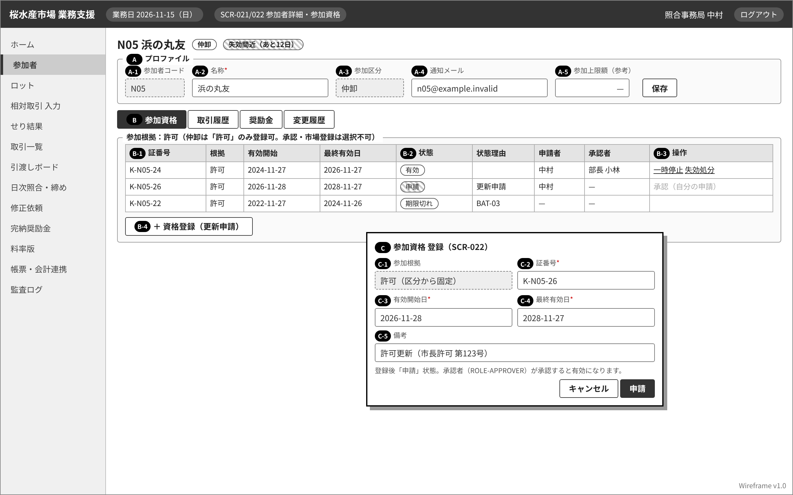

# SCR-021 参加者詳細・編集 / SCR-022 参加資格の登録・状態変更

| Screen ID | SCR-021, SCR-022 | Screen Name | 参加者詳細・参加資格 | Created by | An (+ Claude) |
|---|---|---|---|---|---|
| **Feature ID / Name** | FT-02-01 プロファイル, FT-02-02 参加資格, FT-02-03 状態遷移 | **Created date** | 2026-11-15 | **Design URL** | [wireframes.html#SCR-021-022](../../../03_Design-UIUX/wireframes/wireframes.html) |

## Layout

## Description

Nơi duy nhất thay đổi tư cách tham gia. Ràng buộc đặc thù: **căn cứ bị cố định theo loại người tham gia** (仲卸 chỉ có 許可, 売買参加者 chỉ có 承認, 卸売業者 市場登録, 買出人 取引地点登録 — BR-01, ADR-002), người tạo ≠ người duyệt (02-08). Gia hạn = **dòng mới** ở trạng thái 申請, không sửa ngày của dòng cũ → lịch sử tư cách tại mọi ngày truy được (EX-TRADE-01).

## View

| ID | Item | Type | Required | Validation | Min | Max | Data Source | API ID | Key | Note |
|---|---|---|---|---|---|---|---|---|---|---|
| A-1 | 参加者コード | Label | — | | | | API | PTY-02 | `code` | Không sửa |
| A-2 | 名称 | Text | ○ | String | 1 | 100 | API | PTY-04 | `name` | |
| A-3 | 参加区分 | Label | — | | | | API | PTY-02 | `party_type` | Không sửa sau khi tạo (đổi loại = người tham gia mới) |
| A-4 | 通知メール | Email | × | M_13 | | 254 | API | PTY-04 | `email` | Dùng cho thông báo 失効間近 / 支払期日 (Q-24) |
| A-5 | 参加上限額 | Number | × | Integer ≥ 0 | | | API | PTY-04 | `limit_amount` | Chỉ hiển thị, không chặn giao dịch (Q-18) |
| B | Tab 参加資格 | Tabs | — | | | | | | | Tab khác: 取引履歴 (TRD-01 `buyer=`), 奨励金 (INC-02), 変更履歴 (AUD-01) |
| B-1 | 証番号 | Label | — | | | | API | PTY-02 | `qualifications[].certificate_no` | Sắp xếp `valid_from desc` |
| B-2 | 状態 | Badge | — | | | | API | PTY-02 | `status` + cờ 失効間近 | SM-01 |
| B-3 | 操作 | Link | — | | | | API | PTY-06 | `action` | Chỉ hiện hành động hợp lệ theo trạng thái (bảng State) |
| B-4 | ＋資格登録 | Button | — | | | | — | — | | Mở C |
| C-1 | 参加根拠 | Label | — | | | | Calc | — | theo A-3 | **Không có lựa chọn** — đây là điểm khác chủ ý với form chung |
| C-2 | 証番号 | Text | ○ | String | 1 | 30 | Input | PTY-05 | `certificate_no` | |
| C-3 | 有効開始日 | Date | ○ | Date | | | Input | PTY-05 | `valid_from` | |
| C-4 | 最終有効日 | Date | ○ | ≥ C-3 | | | Input | PTY-05 | `valid_to` | Nhãn 「最終有効日」 (không dùng 「失効日」) để tránh hiểu sai Q-19 |
| C-5 | 備考 | Text | × | | | 200 | Input | PTY-05 | `note` | |

## State (hành động theo trạng thái — SM-01)

| Trạng thái dòng | Hành động hiện | Ai | Lý do bắt buộc |
|---|---|---|---|
| 申請 | 承認 / 却下 | ROLE-APPROVER, ≠ người tạo | 却下: có |
| 有効 | 一時停止 / 失効処分 | 一時停止: ROLE-SETTLEMENT; 失効: ROLE-APPROVER | có |
| 一時停止 | 解除 | ROLE-APPROVER | có |
| 期限切れ / 失効 | 更新申請 (= B-4 với dữ liệu gợi ý) | ROLE-SETTLEMENT | — |
| 再審査 | 承認 / 却下 | ROLE-APPROVER | — |

## Permission

Xem: ROLE-TRADE, ROLE-SETTLEMENT, ROLE-APPROVER. Sửa A, đăng ký C, 一時停止: `party.write` (ROLE-SETTLEMENT). 承認/解除/失効: `party.approve` (ROLE-APPROVER). Xem tab 参加資格 ghi `audit_logs.action='PII_READ'` (APPI-01).

## Event

| ID | Given | When | Then |
|---|---|---|---|
| - | — | 初期処理 | GET PTY-02 (profile + qualifications + cờ 失効間近 theo cấu hình 30 ngày) |
| C | Mở từ B-4 | 申請 | POST PTY-05 → dòng mới `申請`; server kiểm tra lại `basis = expected(party_type)` (E-ELG-01 nếu sai — chống gọi API trực tiếp) |
| B-3 | Có quyền | Chọn hành động → nhập lý do | POST PTY-06 `{action, reason}` → hàm `fn_qualification_transition` kiểm tra chuyển trạng thái hợp lệ + maker≠checker |
| - | Hai dòng 有効 chồng ngày | 承認 | Cho phép (gia hạn trước hạn); `fn_check_eligibility` lấy dòng 有効 bao phủ ngày, ưu tiên `valid_from` mới nhất |
