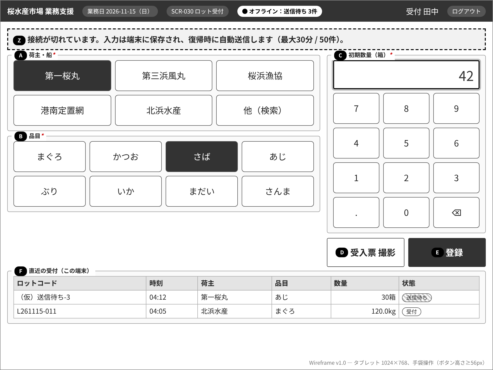

# SCR-030 ロット受付登録 (Tablet)

| Screen ID | SCR-030 | Screen Name | ロット受付登録 | Created by | An (+ Claude) |
|---|---|---|---|---|---|
| **Feature ID / Name** | FT-03-01 ロット受付登録, FT-03-02 受入証憑, FT-03-08 重複検知, FT-16-01 端末内キュー | **Created date** | 2026-11-15 | **Design URL** | [wireframes.html#SCR-030](../../../03_Design-UIUX/wireframes/wireframes.html) |

## Layout

## Description

受付担当 ở khu nhận hàng 02:00〜, môi trường ẩm, ồn, **đeo găng** (PERSONA-DOCK-01). Thay phiếu ロット受領票 giấy + mã tạm dán tay (ASIS-01). Thiết kế: chọn bằng ô lớn (≥ 64px), bàn phím số trên màn hình, không có dropdown nhỏ. Mã lô do server cấp (ADR-012) và **in nhãn ngay** (PRT-01). Màn hình chạy được khi mất mạng ≤ 30 phút (ADR-007).

## View

| ID | Item | Type | Required | Validation | Min | Max | Default | Data Source | API ID | Key / Param | Note |
|---|---|---|---|---|---|---|---|---|---|---|---|
| Z | オフライン帯 | Banner | — | | | | ẩn | Client | — | `navigator.onLine` + heartbeat 10s | Hiện số thao tác chờ gửi (I-SYN-01) |
| A | 荷主・船 | Tile (single) | ○ | Phải chọn | | |荷主 của lô trước (cùng thiết bị) | API (cache offline) | MST-01 | `shippers` (top 5 theo tần suất ngày) | 「他（検索）」 mở danh sách đầy đủ |
| B | 品目 | Tile (single) | ○ | Phải chọn | | | | API (cache) | MST-01 | `items` | Đơn vị (kg/箱/尾) hiện ở tiêu đề C |
| C | 初期数量 | Number keypad | ○ | Decimal(10,1) | 0.1 | 99999.9 | | Input | LOT-02 | `initial_qty` | M_03 nếu 0 |
| D | 受入票 撮影 | Camera | × | jpg/png ≤ 10MB | | | | Input | ATT-01 | `entity=lot` | Offline: lưu blob trong IndexedDB, gửi sau |
| E | 登録 | Button (60px) | — | | | | | API | LOT-02 | `Idempotency-Key: client_uuid` | Offline → vào hàng đợi |
| F | 直近の受付 | Table | — | | | | 10 dòng | API + local queue | LOT-01 | `?day=&created_by=me` | Dòng chờ gửi hiện 「送信待ち」 với mã tạm |

## State

| State | Hiển thị |
|---|---|
| オンライン登録成功 | Toast lớn 「L261115-012 を登録しました」 + tự in PRT-01 (nếu cài máy in) ; reset C, giữ A |
| オフライン登録 | Toast 「端末に保存しました」, dòng F 「送信待ち」 mã tạm `（仮）送信待ち-n` |
| 同期完了 | Mã tạm thay bằng mã thật; nhãn in **sau** khi có mã thật (không in mã tạm — tránh lặp lại ASIS-01) |
| 競合 | Dòng F 「競合」 → chạm mở SCR-160 (ví dụ: ngày đã khóa trong lúc offline) |
| キュー上限 | 30 phút hoặc 50 thao tác → E disable 「オンラインに戻ってから入力」 |

## Permission

ROLE-INTAKE (`lot.write`). ROLE-JUDGE, ROLE-TRADE chỉ xem (SCR-031).

## Event

| ID | Given | When | Then |
|---|---|---|---|
| - | Mở màn hình | 初期処理 | Tải master (cache 24h trong IndexedDB), F |
| E | Online, A/B/C hợp lệ | Chạm 登録 | POST LOT-02 → DD: `fn_lot_receive` (cấp mã, ghi `lots` + `lot_qty_ledger(受付, +qty)` + audit) |
| E | Offline | Chạm 登録 | Ghi IndexedDB `{client_uuid, op:'lot.create', payload, device_time}` |
| - | Mạng trở lại | Tự động | POST SYN-01 tuần tự; kết quả `成功/競合/拒否` cập nhật F (DD-09) |
| - | Lô trùng (cùng 荷主・品目・数量 trong 5 phút) | Chạm 登録 | Cảnh báo 「同じ内容のロットが 04:05 に登録済みです。続けますか」 (DQ-01) — người dùng quyết |
