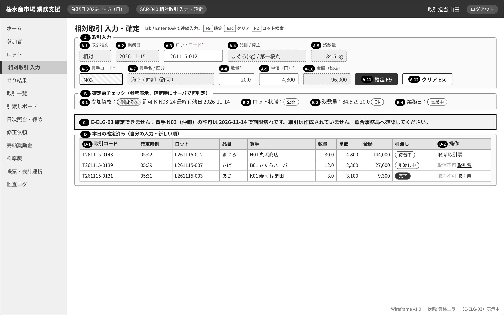

# SCR-040 相対取引 入力・確定

> v1.1 (2026-11-16, LAB-5): sửa tên tham số chống gửi trùng cho khớp API Design (header `Idempotency-Key`, không phải `client_request_id` trong body) — xem PREMISE LAB-5 S-01.

| Screen ID | SCR-040 | Screen Name | 相対取引 入力・確定 | Created by | An (+ Claude) | Updated by | — |
|---|---|---|---|---|---|---|---|
| **Feature ID / Name** | FT-04-01 相対取引登録, FT-04-02 相対取引確定, FT-04-05 取引票 | **Created date** | 2026-11-15 | **Updated date** | — | | |
| **Design URL** | [wireframes.html#SCR-040](../../../03_Design-UIUX/wireframes/wireframes.html) | | | | | | |

> Template: `(Template) [ID] ScreenCategory_ScreenName` (Screen Specification v2.2). Mục **State** và **Permission** là phần thêm (template không có cột riêng).

## Layout

## Description

Màn hình chính của luồng chính (ADR-001). 取引担当 đứng ở 管理卓, nhập liên tục từ 05:00, mục tiêu ≤ 15 giây/giao dịch chỉ bằng bàn phím. Nhập và xác nhận là **một thao tác**: bấm 確定 → server kiểm tra tư cách + số lượng trong 1 transaction (DD-02). Nếu bị từ chối, không có bản ghi nào được tạo (FR-AITAI-02) và dữ liệu vẫn trên form để sửa. Vùng B chỉ là hiển thị tham khảo; quyết định luôn ở server.

Prototype LAB-2 (`/trades/new`): có cùng luồng; khác ở chỗ chưa có F-key, chưa có vùng B kiểm tra trước, lỗi hiện dạng text chung.

## View

| ID | Item | Type | Required | Validation Type | Min | Max | Default | Validation Note | Data Source | API ID | Key / Param | Note |
|---|---|---|---|---|---|---|---|---|---|---|---|---|
| **A** | **取引入力** | | | | | | | | | | | |
| A-1 | 取引種別 | Label | — | — | | | 相対 | | Const | — | — | Cố định; せり ở SCR-051 |
| A-2 | 業務日 | Label | — | Date | | | ngày nghiệp vụ hiện tại | | API | AUTH-04 | `business_day` | Không sửa được; giao dịch luôn thuộc ngày hiện tại |
| A-3 | ロットコード | Text + suggest | ○ | String `^L\d{6}-\d{3}$` | 11 | 11 | (trống) | M_01, M_13 | API | LOT-01 | `?day=&status=公開,売買確定&q=` | Gõ 3 số cuối → gợi ý lô của ngày; F2 mở danh sách. Sau blur: điền A-4, A-5 |
| A-4 | 品目 / 荷主 | Label | — | — | | | | | API | LOT-03 | `item.name, item.unit, shipper.name` | |
| A-5 | 残数量 | Label | — | Number | | | | | API | LOT-03 | `available_qty` | Kèm đơn vị; giá trị tại lúc đọc, có thể cũ |
| A-6 | 買手コード | Text + suggest | ○ | String `^[A-Z]\d{2,4}$` | 2 | 10 | | M_01, M_14 | API | PTY-01 | `?q=` | Sau blur gọi PTY-07 → điền A-7, B-1 |
| A-7 | 買手名 / 区分 | Label | — | — | | | | | API | PTY-07 | `name, party_type, basis` | |
| A-8 | 数量 | Number | ○ | Decimal(10,1) | 0.1 | 99999.9 | | M_01, M_03 (>0), M_08 | Input | TRD-02 | `qty` | Đơn vị theo 品目 |
| A-9 | 単価（円） | Number | ○ | Integer | 0 | 9,999,999 | | M_01, M_09 | Input | TRD-02 | `unit_price` | 単価0 cho phép (hàng tặng) — xác nhận ở Q-04 |
| A-10 | 金額（税抜） | Label | — | Integer | | | | | Calc | — | `floor(qty × unit_price)` | Tính ở client để xem; server tính lại |
| A-11 | 確定 (F9) | Button | — | | | | | | API | TRD-02 | body A-3, A-6, A-8, A-9; header `Idempotency-Key` (UUID sinh khi mở form, đổi sau mỗi lần thành công) | Disable khi đang gửi (chống bấm 2 lần) |
| A-12 | クリア (Esc) | Button | — | | | | | | — | — | — | |
| **B** | **確定前チェック** | | | | | | | | | | | |
| B-1 | 参加資格 | Badge + text | — | — | | | | | API | PTY-07 | `status, basis, certificate_no, valid_to, days_left` | 有効 / 失効間近(W-ELG-01) / 期限切れ / 一時停止 / 未登録 |
| B-2 | ロット状態 | Badge | — | | | | | | API | LOT-03 | `status` | |
| B-3 | 残数量判定 | Badge | — | | | | | | Calc | — | A-5 ≥ A-8 | |
| B-4 | 業務日状態 | Badge | — | | | | | | API | AUTH-04 | `business_day_status` | 営業中 / ロック済 / 休市 |
| **C** | **メッセージ** | Message area | — | | | | | | API | TRD-02 | `error_code, message` | §2 Common Message; thành công: 「T261115-0144 を確定しました」 |
| **D** | **本日の確定済み** | | | | | | | | | | | |
| D-1 | 一覧 (10 dòng mới nhất, của người dùng) | Table | — | | | | | | API | TRD-01 | `?day=&type=相対&created_by=me&limit=10` | Cột: 取引コード, 確定時刻, ロット, 品目, 買手, 数量, 単価, 金額, 引渡し |
| D-2 | 取消 / 取引票 | Link | — | | | | | | API | TRD-04 / RPT-01 (PRT-02) | | 取消: chỉ khi ngày chưa khóa và chưa có giao hàng → modal nhập lý do (bắt buộc, ≤200) |

## State (画面状態)

| State | Điều kiện | Hiển thị |
|---|---|---|
| 入力中 | Mặc định | Focus A-3 |
| 送信中 | Sau F9 | A-11 disable + spinner; mọi phím F9 bị bỏ qua |
| 確定成功 | API 201 | Message thành công ở C, thêm dòng đầu D, **xóa A-3〜A-9, focus A-3** (để nhập tiếp) |
| 拒否 | API 409 | Message lỗi ở C (đậm), giữ dữ liệu, focus trường liên quan: E-ELG-* → A-6, E-LOT-* → A-3/A-8 |
| ロック済 / 休市 | B-4 ≠ 営業中 | Toàn bộ vùng A disable, message E-TRD-01/02 |
| オフライン | Mất mạng | A-11 disable + 「オンラインで確定してください」 (ADR-007 — không xác nhận offline) |

## Permission

| Vai trò | Quyền |
|---|---|
| ROLE-TRADE | Xem + nhập + xác nhận + hủy (`trade.write`) |
| ROLE-SETTLEMENT, ROLE-APPROVER | Không vào màn hình này (xem giao dịch ở SCR-041) |
| Khác | CS-02 |

## Event

| ID | Given (Pre-condition) | When (Trigger/Action) | Then (Result) |
|---|---|---|---|
| # | **Initializing Process（初期処理）** | | |
| - | Có `trade.write` | Mở màn hình | 1. Gọi AUTH-04 lấy ngày nghiệp vụ + trạng thái ngày → B-4. 2. Gọi TRD-01 → D. 3. Focus A-3 |
| # | **Standard Process（通常処理）** | | |
| A-3 | — | Blur / Enter | Gọi LOT-03. Không tìm thấy → M_14 dưới A-3. Lô không ở `公開/売買確定` → B-2 badge cảnh báo (vẫn cho nhập; server sẽ từ chối E-LOT-01) |
| A-6 | — | Blur / Enter | Gọi PTY-07 `day=A-2` → B-1. Nếu `期限切れ/一時停止/未登録` hiện cảnh báo ngay (không chặn — server quyết định) |
| A-8, A-9 | — | Nhập | Tính A-10, B-3 |
| A-11 | Form hợp lệ phía client | F9 / Enter ở A-9 / click | POST TRD-02 `{lot_code, buyer_code, qty, unit_price}` + header `Idempotency-Key` → xem State |
| D-2 取消 | Giao dịch của ngày chưa khóa, chưa giao | Click 取消 → nhập lý do → OK | POST TRD-04; thành công: dòng D đổi trạng thái 取消, A-5 cập nhật nếu cùng lô |
| A-12 | — | Esc | Xóa A-3〜A-9, C; focus A-3 |
| # | **Error Handling（エラー制御）** | | |
| - | 2 người xác nhận cùng lô cùng lúc | F9 | Người sau nhận E-LOT-02 với số khả dụng mới (server khóa dòng lô) |
| - | Hết phiên | F9 | Lưu form tạm trong trang → màn hình đăng nhập → quay lại khôi phục form (không tự gửi) |
| - | Timeout mạng (>10s) | F9 | Message 「通信エラー。取引一覧で確定済みか確認してください」; gửi lại cùng `Idempotency-Key` → server trả kết quả cũ (idempotent), không tạo giao dịch thứ 2 |
