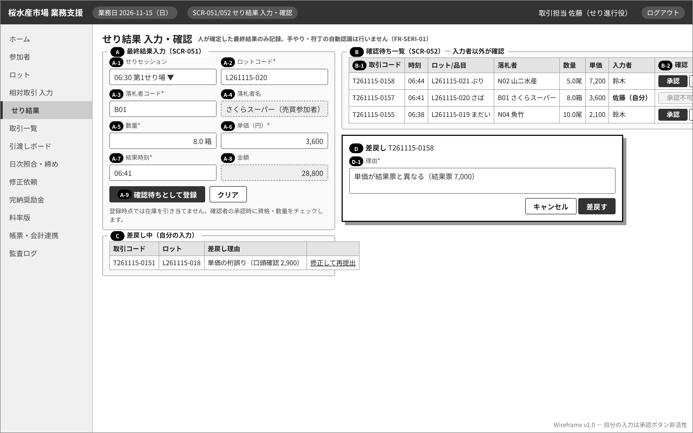

# SCR-051 せり結果入力 / SCR-052 せり結果確認・承認

| Screen ID | SCR-051, SCR-052 | Screen Name | せり結果 入力・確認 | Created by | An (+ Claude) |
|---|---|---|---|---|---|
| **Feature ID / Name** | FT-05-02 せり最終結果入力, FT-05-03 せり結果確認・確定 | **Created date** | 2026-11-15 | **Design URL** | [wireframes.html#SCR-051-052](../../../03_Design-UIUX/wireframes/wireframes.html) |

## Layout

## Description

Luồng phụ (~10%). せり進行役 chỉ ghi **kết quả cuối** (落札者・数量・単価・時刻) sau khi người điều hành đã chốt bằng 手やり/符丁 — hệ thống không điều hành phiên, không đọc ký hiệu (FR-SERI-01, ADR-001). Kết quả vào trạng thái `確認待ち`; **người khác** (ROLE-TRADE khác hoặc ROLE-APPROVER) xác nhận → lúc đó mới kiểm tra tư cách + trừ số lượng (DD-03). Hai màn hình gộp 1 trang vì cùng người dùng đứng ở 管理卓 (giống prototype `/seri`).

## View

| ID | Item | Type | Required | Validation | Min | Max | Default | Data Source | API ID | Key / Param | Note |
|---|---|---|---|---|---|---|---|---|---|---|---|
| **A** | **最終結果入力 (SCR-051)** | | | | | | | | | | |
| A-1 | せりセッション | Select | × | — | | | phiên gần nhất | API | MST-01 | `seri_sessions?day=` | Tùy chọn (SCR-050 không bắt buộc) |
| A-2 | ロットコード | Text + suggest | ○ | `^L\d{6}-\d{3}$` | | | | API | LOT-01 | `status=公開` | |
| A-3 | 落札者コード | Text + suggest | ○ | String | 2 | 10 | | API | PTY-01 | | Không kiểm tra tư cách ở bước này (chỉ cảnh báo W-ELG) |
| A-4 | 落札者名 | Label | — | | | | | API | PTY-07 | `name, party_type` | |
| A-5 | 数量 | Number | ○ | Decimal(10,1) | 0.1 | 99999.9 | | Input | SER-01 | `qty` | |
| A-6 | 単価（円） | Number | ○ | Integer | 0 | 9,999,999 | | Input | SER-01 | `unit_price` | |
| A-7 | 結果時刻 | Time | ○ | HH:mm, thuộc ngày nghiệp vụ | 02:00 | 01:59 | giờ hiện tại | Input | SER-01 | `seri_time` | |
| A-8 | 金額 | Label | — | | | | | Calc | — | | |
| A-9 | 確認待ちとして登録 | Button | — | | | | | API | SER-01 | | Enter ở A-7 |
| **B** | **確認待ち一覧 (SCR-052)** | | | | | | | | | | |
| B-1 | 一覧 | Table | — | | | | | API | TRD-01 | `?type=せり&status=確認待ち&day=` | Tự làm mới 15 giây/lần |
| B-2 | 承認 / 差戻し | Button | — | | | | | API | SER-02 / SER-03 | | Dòng do chính mình nhập: hiện nút disable 「承認不可（職務分離）」 (CS-03) |
| **C** | **差戻し中（自分の入力）** | Table + link | — | | | | | API | TRD-01 | `?type=せり&status=差戻し&created_by=me` | 「修正して再提出」 nạp lại vào A |
| **D** | **差戻し modal** | | | | | | | | | | |
| D-1 | 理由 | Textarea | ○ | String | 1 | 200 | | Input | SER-03 | `reason` | |

## State

| State | Hiển thị |
|---|---|
| 登録成功 | Thêm dòng vào B (nhãn 「自分」), xóa A-2〜A-7, focus A-2 |
| 承認成功 | Dòng biến khỏi B; toast 「T… を確定しました」 |
| 承認拒否 (E-ELG-*, E-LOT-02) | Message ở đầu B, dòng vẫn ở 確認待ち; người xác nhận chọn 差戻し kèm lý do (ví dụ "落札者の許可期限切れ") |
| 差戻し | Dòng chuyển sang C của người nhập |

## Permission

| Vai trò | 入力 (SER-01) | 承認/差戻し (SER-02/03) |
|---|---|---|
| ROLE-TRADE | ○ | ○ (trừ bản ghi của mình) |
| ROLE-APPROVER | × | ○ |

## Event

| ID | Given | When | Then |
|---|---|---|---|
| # | **初期処理** | | |
| - | Có `seri.write` hoặc `seri.approve` | Mở | Load A-1, B, C. Người chỉ có `seri.approve` không thấy vùng A |
| # | **通常処理** | | |
| A-9 | Form hợp lệ | Enter/click | POST SER-01 → trade `status=確認待ち`, **không** trừ số lượng lô |
| B-2 承認 | `created_by ≠ me` | Click | POST SER-02 → DD-03: kiểm tra §4 bảng quyết định (8 điều kiện) → `確定`, trừ lô, ghi `trade_entries#1` |
| B-2 差戻し | `created_by ≠ me` | Click → D | POST SER-03 `reason` → `差戻し` |
| C | Bản ghi 差戻し của mình | 「修正して再提出」 | Nạp vào A; A-9 gọi SER-01 với `trade_code` cũ → trạng thái lại `確認待ち` (giữ mã, BR-14) |
| # | **エラー制御** | | |
| - | Hai người cùng bấm 承認 1 dòng | Click | Người sau nhận 409 「既に確定済みです」, danh sách làm mới |
| - | Ngày bị khóa khi còn 確認待ち | — | Không xảy ra: khóa ngày yêu cầu 0 giao dịch 確認待ち (E-STL-01) |
