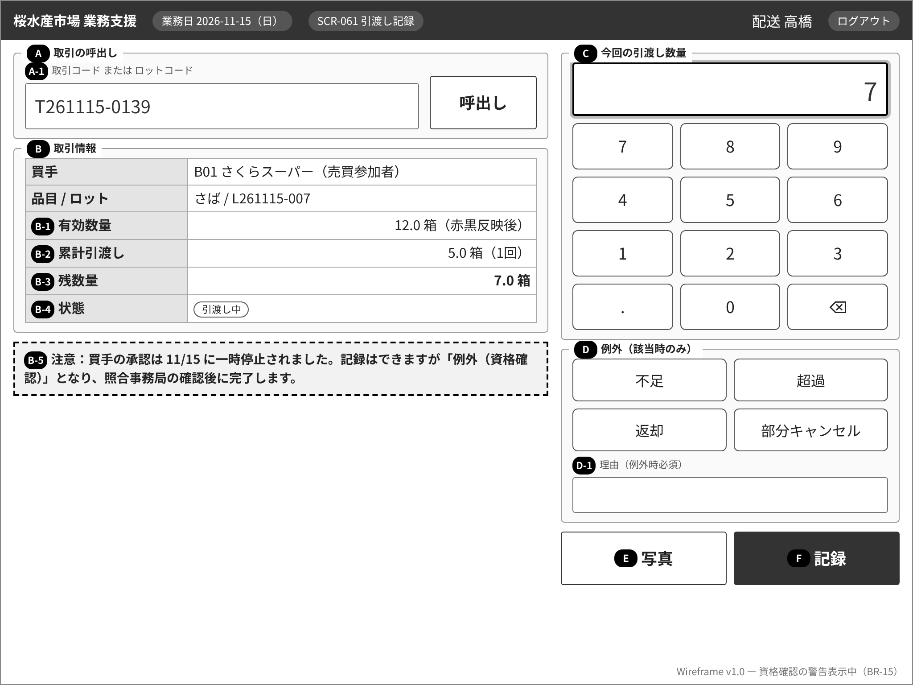

# SCR-061 引渡し記録 (Tablet)

| Screen ID | SCR-061 | Screen Name | 引渡し記録入力 | Created by | An (+ Claude) |
|---|---|---|---|---|---|
| **Feature ID / Name** | FT-06-02 分割引渡し, FT-06-03 完了判定, FT-06-04 例外登録, FT-16-01 端末内キュー | **Created date** | 2026-11-15 | **Design URL** | [wireframes.html#SCR-061](../../../03_Design-UIUX/wireframes/wireframes.html) |

## Layout

## Description

配送担当 ghi từng lần giao (chia nhiều lần do xe — EX-DEL-02), ngoại lệ 不足/超過/返却/部分キャンセル có lý do + ảnh. Thay cho FAX + điện thoại xác nhận (PP-02: 14 cuộc gọi/ngày cao điểm). Giao xong chỉ khi tổng = số lượng hiệu lực (sau 赤黒) — BR-07. Nếu tư cách người mua đã có vấn đề sau khi bán → vẫn ghi nhưng thành 例外(資格確認) (BR-15, Q-28). Offline được (ADR-007).

## View

| ID | Item | Type | Required | Validation | Min | Max | Data Source | API ID | Key / Param | Note |
|---|---|---|---|---|---|---|---|---|---|---|
| A-1 | 取引コード / ロットコード | Text | ○ | `^T\d{6}-\d{4}$` hoặc mã lô | | | Input | TRD-03 / TRD-01 | | Mã lô → danh sách giao dịch của lô để chọn. (Option B: quét QR thay ô này) |
| B | 取引情報 | Table | — | | | | API | TRD-03 | `buyer, item, lot` | |
| B-1 | 有効数量 | Label | — | | | | API | TRD-03 | `effective_qty` | = tổng `trade_entries` (ADR-004) |
| B-2 | 累計引渡し | Label | — | | | | API | TRD-03 | `delivered_qty, delivery_count` | Không tính dòng ngoại lệ |
| B-3 | 残数量 | Label | — | | | | Calc | — | B-1 − B-2 | |
| B-4 | 状態 | Badge | — | | | | API | TRD-03 | `delivery_status` | SM-05 |
| B-5 | 資格警告 | Banner | — | | | | API | PTY-07 | `day=today` | Hiện khi ≠ 有効 (W-DEL-01) |
| C | 今回の引渡し数量 | Number keypad | ○* | Decimal(10,1) | 0 | B-3 (nếu không ngoại lệ) | Input | DEL-02 | `qty` | Mặc định = B-3 (giao hết) — người dùng sửa nếu giao một phần. *0 chỉ hợp lệ khi có ngoại lệ |
| D | 例外種別 | Tile (toggle) | × | 1 trong 4 | | | Input | DEL-02 | `exception_type` | 資格確認 do server tự gán, không có trên màn hình |
| D-1 | 理由 | Text | D chọn → ○ | String | 1 | 200 | Input | DEL-02 | `reason` | E-DEL-02 |
| E | 写真 | Camera | × (khuyến nghị khi D) | ≤10MB | | | Input | ATT-01 | `entity=delivery` | DR-IMAGE-01, không AI phân tích |
| F | 記録 | Button | — | | | | API | DEL-02 | `Idempotency-Key` | |

## State

| Kết quả DEL-02 | Hiển thị |
|---|---|
| `引渡し中` | 「1回目 5.0箱 を記録。残 7.0箱」 |
| `完了` | Toast lớn 「引渡し完了」, nút in PRT-03 |
| `例外` | 「例外として記録。照合事務局の確認待ち」 — giao dịch hiện trên SCR-060 cột 例外 |
| 409 E-DEL-01 | Tổng vượt → gợi ý chọn 「超過」 |
| Offline | Như SCR-030; xung đột (giao dịch bị hủy, giao vượt do người khác đã ghi) → SCR-160 |

## Permission

ROLE-DELIVERY (`delivery.write`). Giải quyết ngoại lệ (`delivery.resolve`) là ROLE-SETTLEMENT ở SCR-062, người giải quyết ≠ người ghi (BR-11 điểm 4).

## Event

| ID | Given | When | Then |
|---|---|---|---|
| A-1 | — | Enter | GET TRD-03 + PTY-07 → B, B-5; C = B-3 |
| F | Giao dịch `確定`, chưa `完了` | Chạm 記録 | POST DEL-02 → DD-04 |
| - | Ngày của giao dịch đã khóa | Chạm 記録 | **Cho phép** (BR-06 ngoại lệ: tiến độ giao hàng sau khóa); bản ghi `deliveries.recorded_at` ở ngày hiện tại |
| - | Giao dịch bị 赤黒 giảm số lượng sau khi đã giao một phần | Mở | B-1 hiển thị số mới; nếu B-2 > B-1 → trạng thái 例外(超過) do server, cần 照合事務局 xử lý |
