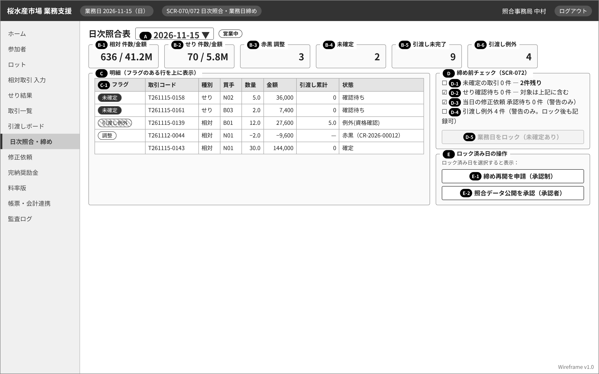

# SCR-070 日次照合表 / SCR-072 業務日締め

| Screen ID | SCR-070, SCR-072 | Screen Name | 日次照合・業務日締め | Created by | An (+ Claude) |
|---|---|---|---|---|---|
| **Feature ID / Name** | FT-07-01 日次照合表, FT-07-03 ロック・締め再開, FT-07-05 照合データ公開承認 | **Created date** | 2026-11-15 | **Design URL** | [wireframes.html#SCR-070-072](../../../03_Design-UIUX/wireframes/wireframes.html) |

## Layout

## Description

照合事務局 gom giao dịch, giao hàng, ngoại lệ của 1 ngày nghiệp vụ (thay 5 nguồn dữ liệu của LOG-RPT-01), rồi **khóa ngày**. Sau khóa: không sửa trực tiếp (BR-06), BAT-01/02 chạy báo cáo + IF-ACC-01 (trước 11:00). Mở lại ngày là thao tác nhạy cảm (02-08): xin → người khác duyệt. 公開 = phát hành dữ liệu đối chiếu cho kế toán, sau đó không mở lại được.

## View

| ID | Item | Type | Data Source | API ID | Key / Param | Note |
|---|---|---|---|---|---|---|
| A | 業務日 | Date select | API | STL-01 | `day` | Mặc định ngày hiện tại; danh sách 14 ngày gần nhất kèm trạng thái |
| B-1〜B-6 | Thẻ tổng hợp | Tile | API | STL-01 | `summary.aitai, seri, adjustments, unconfirmed, delivery_open, delivery_exception` | Số liệu từ `trade_entries` của ngày (gồm 赤黒 ghi vào ngày này) |
| C | 明細 | Table, sort theo cờ | API | STL-01 | `rows[]` | Cờ: 未確定 / 引渡し例外 / 引渡し未完了 / 調整 / 紛争. Click → SCR-042 |
| D-1〜D-4 | 締め前チェック | Checklist | API | STL-01 | `lock_checks[]` | D-1, D-2 **chặn**; D-3, D-4 chỉ cảnh báo |
| D-5 | 業務日をロック | Button | API | STL-02 | | Enable khi mọi check chặn = OK; modal xác nhận 「ロック後は修正依頼でのみ変更できます」 |
| E-1 | 締め再開を申請 | Button + modal (理由 ○, ≤200) | API | STL-03 | `reason` | Chỉ khi `ロック済` (chưa 公開) |
| E-2 | 照合データ公開を承認 | Button | API | STL-06 | | ROLE-APPROVER; sau khi BAT-02 tạo file thành công |
| (ẩn) | 再開申請の承認/却下 | Button | API | STL-04 | `decision` | Hiện cho ROLE-APPROVER khi `再開申請中`, người duyệt ≠ người xin |

## State (SM-06)

| Trạng thái ngày | D-5 | E-1 | E-2 | Ghi chú |
|---|---|---|---|---|
| 営業中 | ○ (nếu check OK) | — | — | |
| ロック済 | — | ○ | ○ | Nhãn CS-09 trên mọi màn hình chi tiết của ngày |
| 再開申請中 | — | — | — | Hiện lý do + người xin; APPROVER thấy nút duyệt |
| 公開済 | — | — | — | Chỉ sửa bằng 赤黒 vào ngày sau |

## Permission

Xem: ROLE-SETTLEMENT, ROLE-APPROVER. D-5, E-1: `settle.lock`, `settle.reopen.request`. Duyệt mở lại, E-2: `settle.reopen.approve`, `settle.publish`.

## Event

| ID | Given | When | Then |
|---|---|---|---|
| A | — | Đổi ngày | GET STL-01 |
| D-5 | Check chặn OK | Click → xác nhận | POST STL-02 → DD-05 (`fn_lock_business_day`): khóa dòng ngày, đếm lại trong transaction (E-STL-01 nếu có giao dịch mới vừa thêm), `status=ロック済`, outbox sự kiện `day.locked` → BAT-01/02 chạy ngay |
| E-1 | ロック済 | Gửi lý do | POST STL-03 → `再開申請中` + thông báo APPROVER |
| 承認 | 再開申請中, actor ≠ requester | Click | POST STL-04 `approve` → `営業中`; file IF-ACC cũ (nếu đã tạo) đánh dấu `差替済` |
| - | 10:30 mà ngày hôm đó chưa khóa | BAT (cảnh báo) | Thông báo Critical 「締め遅延」 (Q-24) vì BATCH-01 phải xong trước 11:00 |
