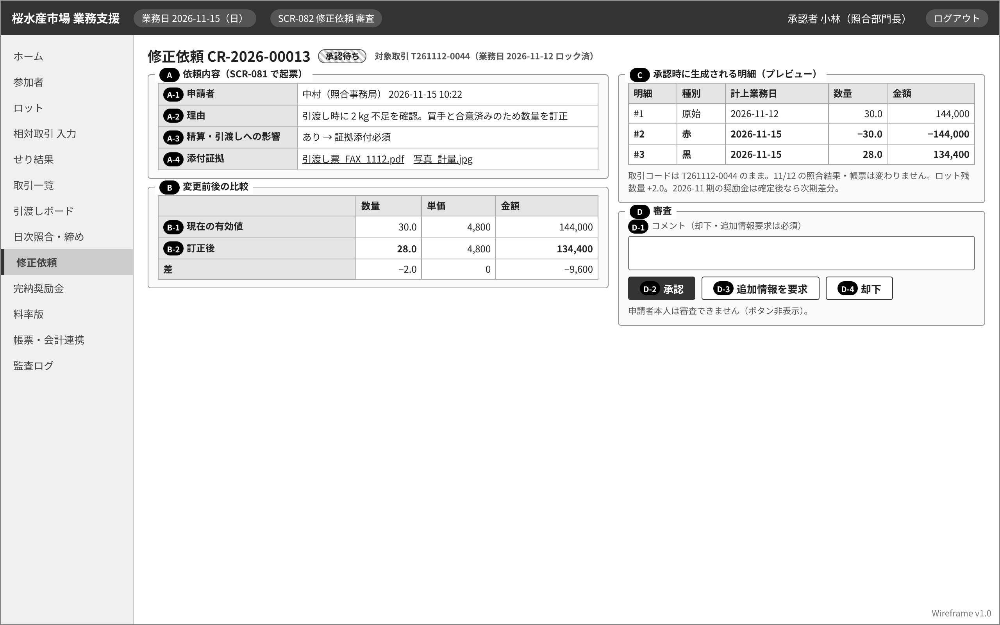

# SCR-081 修正依頼起票 / SCR-082 修正依頼審査

| Screen ID | SCR-081, SCR-082 | Screen Name | 修正依頼 起票・審査 | Created by | An (+ Claude) |
|---|---|---|---|---|---|
| **Feature ID / Name** | FT-08-01 起票, FT-08-02 審査, FT-08-03 赤黒生成 | **Created date** | 2026-11-15 | **Design URL** | [wireframes.html#SCR-081-082](../../../03_Design-UIUX/wireframes/wireframes.html) |

## Layout

(Ảnh là SCR-082; SCR-081 là form gồm các trường vùng A + B-2, mở từ SCR-042 nút 「修正依頼を起票」.)

## Description

Cách duy nhất thay đổi giao dịch đã xác nhận ở ngày đã khóa (BR-06, FORM-CORR-01). Người duyệt thấy **trước** các bút toán sẽ sinh (vùng C) — để biết rõ hệ quả lên ngày nào, lô nào, kỳ 奨励金 nào. Bút toán ghi dưới cùng `trade_code` (ADR-004), ngày gốc không đổi.

## View

| ID | Item | Type | Required | Validation | Data Source | API ID | Key | Note |
|---|---|---|---|---|---|---|---|---|
| **SCR-081** | | | | | | | | |
| 81-1 | 対象取引 | Label | — | | API | TRD-03 | `trade_code, business_day, effective` | Từ SCR-042 |
| 81-2 | 新数量 | Number | ○ | Decimal ≥ 0 | Input | COR-02 | `new_qty` | 0 = hủy toàn bộ sau khóa |
| 81-3 | 新単価 | Number | ○ | Integer ≥ 0 | Input | COR-02 | `new_unit_price` | Ít nhất 1 trong 2 phải khác giá trị hiệu lực (M_07) |
| 81-4 | 修正理由 | Textarea | ○ | 1〜500 | Input | COR-02 | `reason` | |
| 81-5 | 精算・引渡しへの影響 | Radio あり/なし | ○ | | Input | COR-02 | `affects_settlement` | あり → 81-6 bắt buộc (E-COR-01, D.4) |
| 81-6 | 添付証拠 | File (multi) | 条件 | pdf/jpg/png ≤10MB | Input | ATT-01 | `entity=correction` | |
| **SCR-082** | | | | | | | | |
| A-1〜A-4 | 依頼内容 | Table | — | | API | COR-06 | | |
| B-1 | 現在の有効値 | Label | — | | API | COR-06 | `current` | Tổng bút toán hiện tại (có thể đã sửa trước đó — A4-02) |
| B-2 | 訂正後 | Label | — | | API | COR-06 | `proposed` | Chữ đậm phần khác |
| C | 生成される明細 | Table | — | | API | COR-06 | `preview_entries[]` | Tính bởi server (cùng logic DD-06, chế độ dry-run) |
| D-1 | コメント | Textarea | 却下・追加情報 → ○ | ≤500 | Input | COR-03/04/05 | `comment` | |
| D-2/3/4 | 承認 / 追加情報を要求 / 却下 | Button | — | | API | COR-03 / COR-05 / COR-04 | | Ẩn với người tạo (E-SOD-01) |

## State (SM-07)

| Trạng thái | SCR-082 hiển thị |
|---|---|
| 承認待ち | D đầy đủ (người duyệt) |
| 追加情報要求 | Readonly + comment; người tạo thấy nút 「補足して再提出」 ở SCR-080 |
| 承認 | Link tới 2 bút toán đã sinh; nhãn 「次期差分の対象」 nếu kỳ 奨励金 của ngày gốc đã 確定 |
| 却下 | Readonly + comment |

## Permission

Tạo: `correction.request` (ROLE-TRADE, ROLE-SETTLEMENT). Duyệt: `correction.approve` (ROLE-APPROVER) và ≠ người tạo.

## Event

| ID | Given | When | Then |
|---|---|---|---|
| 81 | Giao dịch `確定` | 起票 | POST COR-02 → `CR-YYYY-NNNNN`, `承認待ち`, thông báo APPROVER |
| - | — | Mở SCR-082 | GET COR-06 (gồm preview) |
| D-2 | ≠ người tạo, ngày hiện tại chưa khóa | 承認 | POST COR-03 → DD-06: khóa `trades` + `lots`, kiểm tra số lượng lô nếu tăng (E-LOT-02), ghi 赤 + 黒 vào ngày hiện tại, cập nhật `lot_qty_ledger(赤黒)`, `corrections=承認`, audit — 1 transaction |
| D-3 | | 追加情報を要求 | POST COR-05 (comment bắt buộc) |
| D-4 | | 却下 | POST COR-04 (comment bắt buộc) |
| - | Giao dịch đã giao một phần, giảm số lượng < đã giao | 承認 | Vẫn cho; `delivery_status=例外(超過)` để 照合事務局 xử lý (không tự quyết — BR-11) |
