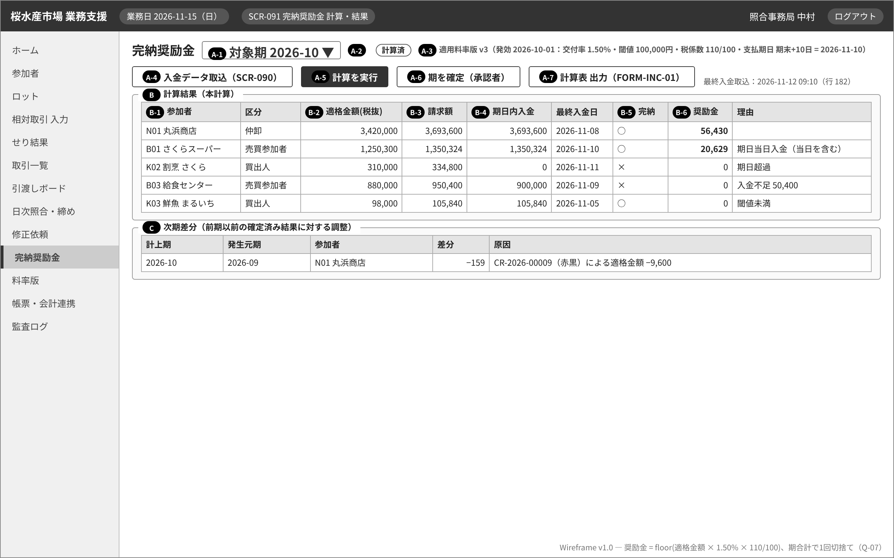

# SCR-091 完納奨励金 計算・結果一覧

| Screen ID | SCR-091 | Screen Name | 奨励金計算・結果一覧 | Created by | An (+ Claude) |
|---|---|---|---|---|---|
| **Feature ID / Name** | FT-09-02 奨励金計算, FT-09-03 次期差分, FT-09-04 結果照会, FT-09-05 計算表出力 | **Created date** | 2026-11-15 | **Design URL** | [wireframes.html#SCR-091](../../../03_Design-UIUX/wireframes/wireframes.html) |

## Layout

## Description

Thay bảng tính cá nhân (US-15). 「完納」 = **trả đủ trong hạn**, không liên quan giao hàng (DOM-05, R-03). Công thức BR-08: `floor(適格金額 × rate_bp/10000 × tax_num/tax_den)` **một lần trên tổng kỳ** (Q-07); = 0 nếu `期日内入金 < 請求額` hoặc `適格金額 < 閾値`. Hạn = cuối kỳ + `payment_due_days`, **tính cả ngày hạn**, không dời theo ngày nghỉ (Q-08). Màn hình luôn hiện **bản料率 đã áp dụng** (FR-AUDIT-03) và **lý do = 0** cho từng dòng — để 照合事務局 trả lời người tham gia mà không cần mở công thức.

## View

| ID | Item | Type | Data Source | API ID | Key | Note |
|---|---|---|---|---|---|---|
| A-1 | 対象期 | Month select | API | INC-02 | `period` | Mặc định tháng trước |
| A-2 | 期の状態 | Badge | API | INC-02 | `status` | 未計算 / 計算済 / 確定 (SM-08) |
| A-3 | 適用料率版 | Label | API | INC-02 | `rate_version{no, effective_from, rate_bp, threshold, tax, due_days}`, `due_date` | Bản có hiệu lực ở **ngày cuối kỳ** (DD-08) |
| A-4 | 入金データ取込 | Button | — | → SCR-090 | | Hiện thời điểm import cuối + số dòng |
| A-5 | 計算を実行 | Button | API | INC-03 | | Khi 確定: đổi nhãn 「再計算（次期差分）」 |
| A-6 | 期を確定 | Button | API | INC-04 | | ROLE-APPROVER, khi 計算済 |
| A-7 | 計算表 出力 | Button | API | RPT-01 | `rpt=RPT-07` | FORM-INC-01, CSV |
| B-1 | 参加者 | Text | API | INC-02 | `results[].party` | Lọc theo loại; mặc định sắp `奨励金 desc` |
| B-2 | 適格金額(税抜) | Number | API | INC-02 | `eligible_amount` | Tổng `trade_entries.amount` của người mua có `business_day` trong kỳ (gồm 赤黒 ghi vào kỳ) |
| B-3 | 請求額 | Number | API | INC-02 | `billed_amount` | Từ dữ liệu kế toán (A4-04). Thiếu dữ liệu → 「未取込」 và 奨励金 không tính |
| B-4 | 期日内入金 | Number | API | INC-02 | `paid_by_due` | Tổng `paid_amount` có `paid_on ≤ due_date` |
| B-5 | 完納 | ○/× | API | INC-02 | `on_time` | |
| B-6 | 奨励金 | Number | API | INC-02 | `incentive_amount` | |
| (B) | 理由 | Text | API | INC-02 | `reason_code` | 期日超過 / 入金不足 {差額} / 閾値未満 / 未取込 / 期日当日入金 |
| C | 次期差分 | Table | API | INC-02 | `deltas[]` | Dòng `kind=次期差分` ghi vào kỳ này, kèm kỳ gốc và nguyên nhân (mã CR) |

## State

| Trạng thái kỳ | A-5 | A-6 | Ý nghĩa của "chạy" |
|---|---|---|---|
| 未計算 | 計算を実行 | — | Tạo `本計算` |
| 計算済 | 再計算 | 期を確定 | **Thay thế** kết quả `本計算` (chưa ai dùng chính thức) |
| 確定 | 再計算（次期差分） | — | Không đổi kết quả; sinh `次期差分` vào kỳ kế tiếp cho phần chênh (BR-09) |

## Permission

Xem: ROLE-SETTLEMENT, ROLE-APPROVER. Chạy: `incentive.run`. Chốt kỳ: `incentive.close` (ROLE-APPROVER). Xuất: `report.export`.

## Event

| ID | Given | When | Then |
|---|---|---|---|
| A-1 | — | Chọn kỳ | GET INC-02 |
| A-5 | Có bản料率 cho kỳ (E-INC-02), đã import thanh toán | Click → xác nhận | POST INC-03 → DD-07 (1 transaction, khóa dòng `incentive_periods`) |
| A-6 | 計算済, actor ≠ người chạy lần cuối | Click | POST INC-04 → 確定 |
| - | Có dòng 「未取込」 | A-5 | Cảnh báo trước khi chạy: 「請求データ未取込の参加者が n 件あります。0円として計算されます」 — người dùng chọn tiếp tục hoặc hủy |
