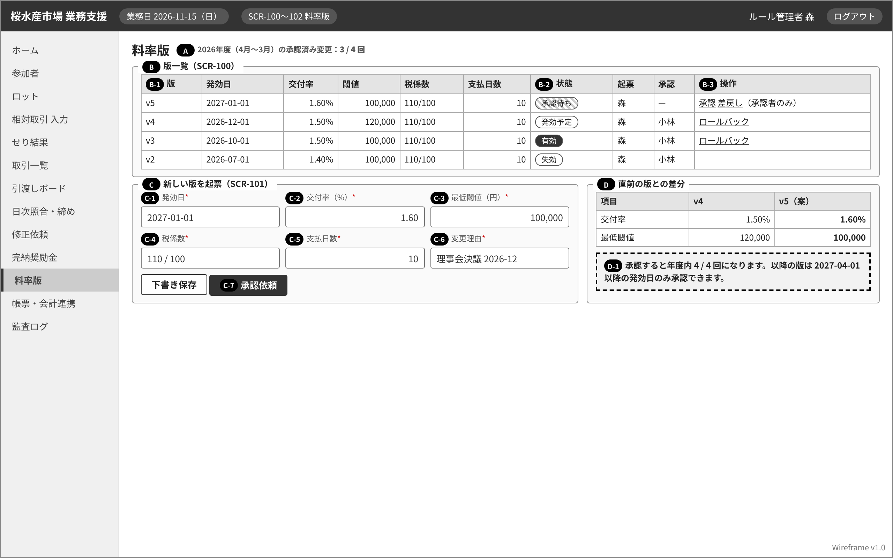

# SCR-100 料率版一覧 / SCR-101 料率版起票 / SCR-102 料率版承認・ロールバック

| Screen ID | SCR-100, SCR-101, SCR-102 | Screen Name | 料率・規程版 | Created by | An (+ Claude) |
|---|---|---|---|---|---|
| **Feature ID / Name** | FT-10-01 起票, FT-10-02 承認, FT-10-03 ロールバック, FT-10-04 版履歴 | **Created date** | 2026-11-15 | **Design URL** | [wireframes.html#SCR-101-102](../../../03_Design-UIUX/wireframes/wireframes.html) |

## Layout

## Description

ルール管理者 đổi tham số 奨励金 mà không cần deploy (NFR-OPS-02). Ràng buộc GOV-RULE-01: tối đa **4 lần/năm** (đếm theo năm tài chính 4月〜3月 — A4-07), người lập ≠ người duyệt, ngày hiệu lực trong tương lai, rollback có dấu vết. Bộ đếm "3 / 4 回" ở đầu màn hình để người lập biết trước khi soạn.

## View

| ID | Item | Type | Required | Validation | Min | Max | Data Source | API ID | Key | Note |
|---|---|---|---|---|---|---|---|---|---|---|
| A | 年度内 承認済み変更回数 | Label | — | | | | API | RAT-01 | `fiscal_year_count{fy, approved, limit:4}` | |
| B-1 | 版一覧 | Table | — | | | | API | RAT-01 | `versions[]` | Cột: 版, 発効日, 交付率, 閾値, 税係数, 支払日数, 状態, 起票, 承認 |
| B-2 | 状態 | Badge | — | | | | API | RAT-01 | `status` | SM-09: 草案 / 承認待ち / 発効予定 / 有効 / 失効 / ロールバック |
| B-3 | 操作 | Link | — | | | | API | RAT-03/04/05 | | Theo bảng State |
| C-1 | 発効日 | Date | ○ | > ngày nghiệp vụ hiện tại; ngày 1 của tháng (khuyến nghị, cảnh báo nếu không) | | | Input | RAT-02 | `effective_from` | E-RAT-01 |
| C-2 | 交付率（%） | Number | ○ | 2 chữ số thập phân | 0.00 | 100.00 | Input | RAT-02 | `rate_bp` (= % × 100) | Lưu bp nguyên để tránh lỗi số thực |
| C-3 | 最低閾値（円） | Number | ○ | Integer | 0 | | Input | RAT-02 | `threshold_amount` | 「以上」で対象 |
| C-4 | 税係数 | Number/Number | ○ | Integer | 1 | 999 | Input | RAT-02 | `tax_numerator/denominator` | Mặc định 110/100; đổi sẽ hiện cảnh báo (Q-06) |
| C-5 | 支払日数 | Number | ○ | Integer | 0 | 90 | Input | RAT-02 | `payment_due_days` | |
| C-6 | 変更理由 | Text | ○ | | 1 | 500 | Input | RAT-02 | `change_reason` | |
| C-7 | 承認依頼 | Button | — | | | | API | RAT-03 | | 草案 → 承認待ち |
| D | 差分 | Table | — | | | | Calc | RAT-01 | so với bản `有効/発効予定` mới nhất | |
| D-1 | 上限警告 | Banner | — | | | | API | RAT-01 | | Hiện khi duyệt bản này làm đạt 4/4 |

## State (hành động theo trạng thái)

| Trạng thái | Hành động | Ai |
|---|---|---|
| 草案 | 編集 / 承認依頼 / 削除 | Người lập (ROLE-RULE-ADMIN) |
| 承認待ち | 承認 / 差戻し | ROLE-APPROVER ≠ người lập; 承認 bị chặn nếu đạt giới hạn năm (E-RAT-02) hoặc `effective_from` đã qua |
| 発効予定, 有効 | ロールバック (lý do ○) | ROLE-RULE-ADMIN |
| 失効, ロールバック | — | |

## Permission

Xem: ROLE-RULE-ADMIN, ROLE-APPROVER, ROLE-SETTLEMENT (chỉ bản 発効予定 trở đi — bản 草案/承認待ち là thông tin nhạy cảm, Encryption Checklist #122). Ghi: `rate.draft`, `rate.approve`, `rate.rollback`.

## Event

| ID | Given | When | Then |
|---|---|---|---|
| C | — | 下書き保存 | POST RAT-02 → 草案 (version_no do `fn_next_code`, không max+1 — GAP-09) |
| C-7 | 草案 của mình | Click | POST RAT-03 → 承認待ち, thông báo APPROVER |
| 承認 | 承認待ち, ≠ người lập | Click | POST RAT-04 → DD-08: kiểm tra năm tài chính, ngày hiệu lực, → 発効予定 |
| ロールバック | 発効予定/有効 | Lý do → OK | POST RAT-05 → ロールバック; nếu là bản 有効 thì bản trước đó tự có hiệu lực lại (fn_resolve_rate) — không tính lại 奨励金 đã 確定; hiện gợi ý 「影響する計算済みの期：2026-11」 |
| - | 02:00 ngày `effective_from` | BAT-05 | 発効予定 → 有効, bản trước → 失効, audit actor = batch |
