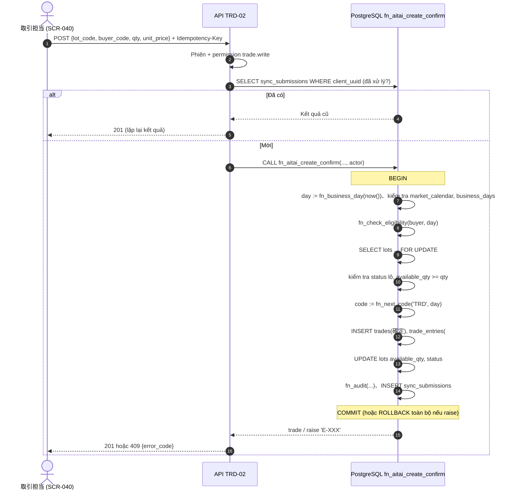
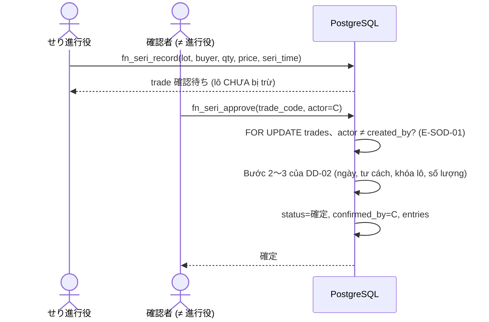
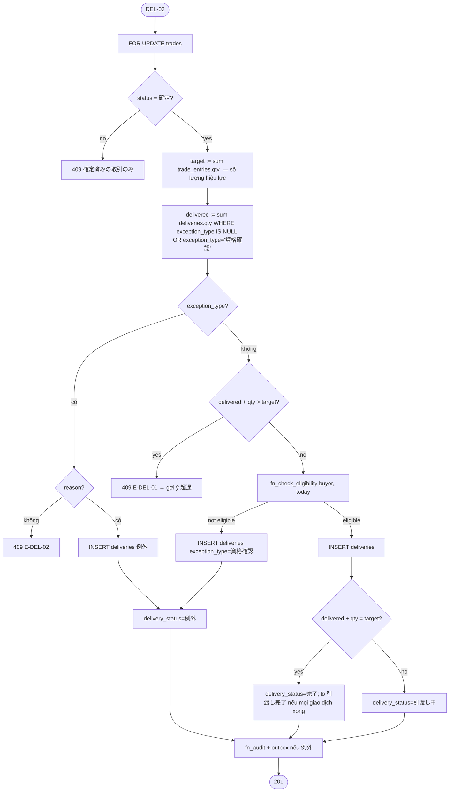
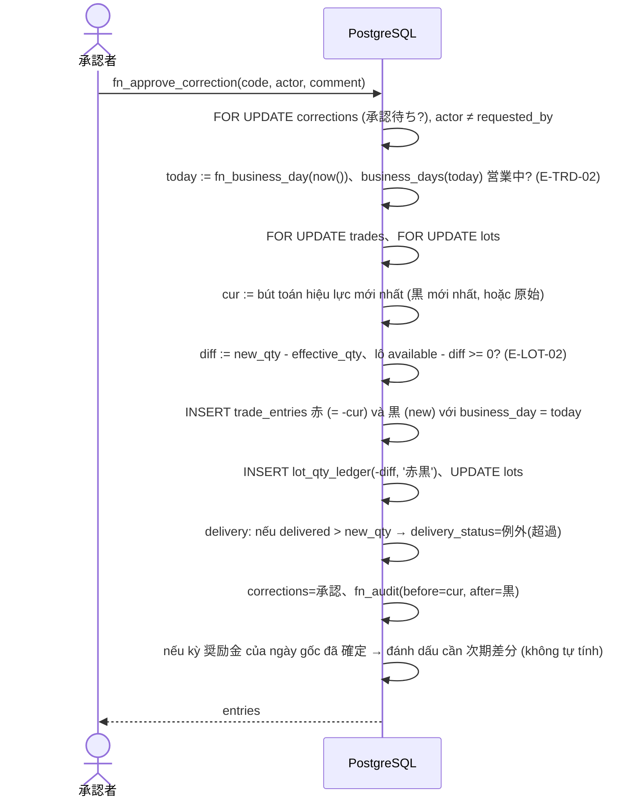
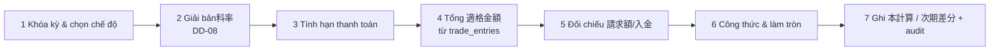
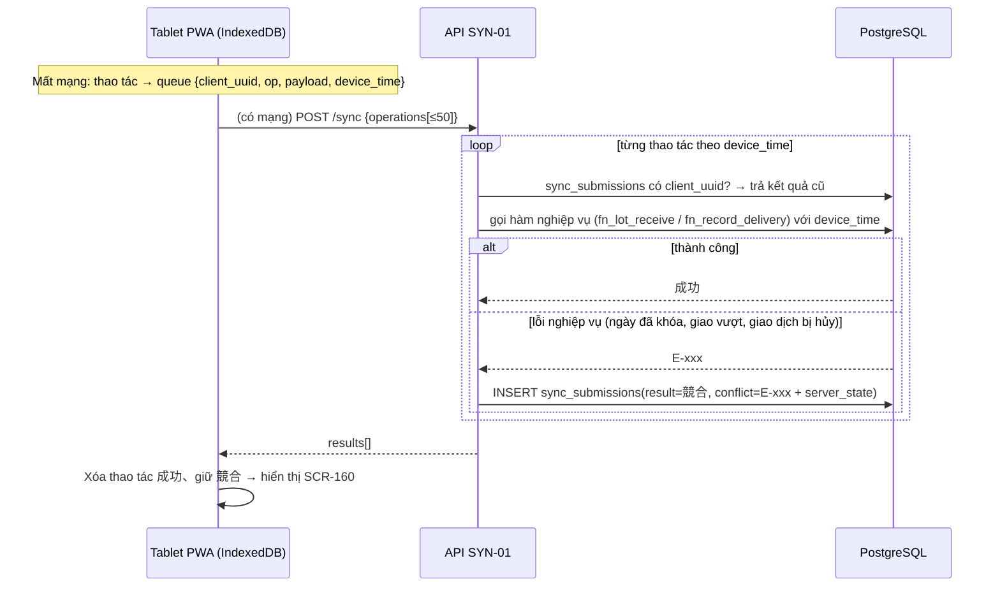

# Detail Design — Product A 桜水産市場

> **Kế thừa template** `[###(ProjectID)] ProjectName - Detail Design (Chart + Description)` (No: BM-QT-1701-31, v1.1). Mỗi chức năng gồm: **Sequence diagram** (sheet `Sample Login`) + **Detail function** chia bước, mỗi bước có Input / Output / Error / Detail (sheet `Detail Design Function_Name`). Mục §0 Logs theo sheet `Logs`.
>
> Chỉ viết chi tiết các chức năng **có ràng buộc nghiệp vụ đặc thù** (theo PREMISE §4). Chữ ký hàm: [Function Specifications](03_Function-Specifications.md). Quy tắc BR-xx / máy trạng thái SM-xx: [Business Rules](../../01_Requirement-Specification/02_Business-Rules-and-State-Machines.md).

## History of changes

| No | Version | Action | Sheet | Description | Updated Date | Updated by |
|---|---|---|---|---|---|---|
| 1 | 1.0 | Add new | DD-01〜DD-09 | Tạo mới | 2026-11-15 | An (+ Claude) |
| 2 | 1.1 | Update | DD-07 b1 | 再計算 không DELETE mà đánh dấu `superseded_at` (mâu thuẫn với BR-16 phát hiện khi break task LAB-5, PREMISE LAB-5 S-02) | 2026-11-16 | An (+ Claude) |

## 0. Logs

| Date time | Log type | Category Name | Message |
|---|---|---|---|
| `[2026-11-15T05:42:11.031+09:00]` | `[INFO]` | `[trade]` | `aitai.confirm trade=T261115-0143 lot=L261115-012 qty=30.0 actor=… ms=38` |
| `[…]` | `[WARN]` | `[trade]` | `aitai.reject code=E-ELG-03 buyer=N03 lot=L261115-012` (lỗi nghiệp vụ = WARN, không phải ERROR) |
| `[…]` | `[ERROR]` | `[acc-export]` | `BAT-02 sftp put failed attempt=2/3 batch=ACC-20261115-01` |

Quy ước: INFO cho mọi thao tác ghi thành công (kèm `ms`), WARN cho 409, ERROR cho 5xx / batch lỗi, FATAL khi DB không kết nối. Không log giá trị PII (tên, email) — chỉ mã. Log là log kỹ thuật; **audit nghiệp vụ nằm ở `audit_logs`**, không thay thế nhau.

---

## DD-01 参加資格判定 `fn_check_eligibility`

Dùng bởi DD-02, DD-03, DD-04 và API PTY-07. Quy tắc: BR-01, BR-02, SM-01. Thay cho `fn_qualification_problem` + `party-qualification-status.ts` của prototype (GAP-03).

### 1. Validate input
| Input | `p_party_id`, `p_day` (ngày nghiệp vụ) |
|---|---|
| Output | — |
| Error | Không tìm thấy người tham gia → `E-ELG-01` |

### 2. Xác định căn cứ cần có
| Detail | 1 | `v_basis := fn_expected_basis(party_type)` — 卸売業者→市場登録, 仲卸→許可, 売買参加者→承認, 買出人→取引地点登録 |
|---|---|---|

### 3. Chọn dòng tư cách áp dụng
| Detail | 1 | Lấy các dòng `basis = v_basis AND valid_from <= p_day` |
|---|---|---|
| | 2 | Ưu tiên: (a) dòng có `status='有効' AND p_day <= valid_to`, mới nhất theo `valid_from`; nếu không có → (b) dòng mới nhất bất kỳ trạng thái (để trả lý do) |
| | 3 | Không có dòng nào → `E-ELG-01` |

### 4. Kết luận
| Output | `(eligible bool, basis, status, valid_to, error_code)` |
|---|---|
| Detail | 1. `status ∈ {一時停止, 失効, 再審査, 申請}` → `E-ELG-02`. 2. `p_day > valid_to` → `E-ELG-03` (kể cả khi BAT-03 chưa chạy — không phụ thuộc batch). 3. Ngược lại eligible. 4. `days_left = valid_to - p_day` để màn hình hiện 失効間近 |

Hàm `STABLE`, không khóa dòng (tư cách thay đổi ở giữa transaction xác nhận là hiếm; chấp nhận theo snapshot của transaction).

---

## DD-02 相対取引 登録・確定 `fn_aitai_create_confirm`

API TRD-02 · Màn hình SCR-040 · BR-02〜04, BR-13, BR-14 · SM-03 · ADR-001, 003, 012

### Sequence diagram

### 1. Validate request
| Input | Request object |
|---|---|
| Output | `lot_code, buyer_code, qty (numeric 10,1), unit_price (int)` |
| Error | Thiếu/sai định dạng → 400 M_01/M_03/M_08/M_13. Thiếu Idempotency-Key → 400 |

### 2. Kiểm tra ngày và tư cách (trong transaction)
| Detail | 1 | `v_day := fn_business_day(now())` |
|---|---|---|
| | 2 | `market_calendar.is_open = false` → raise `E-TRD-01` |
| | 3 | `business_days.status <> '営業中'` → raise `E-TRD-02` (tạo dòng `営業中` nếu chưa có) |
| | 4 | `r := fn_check_eligibility(buyer_id, v_day)`; không eligible → raise `r.error_code` |

### 3. Khóa lô và kiểm tra số lượng
| Detail | 1 | `SELECT * FROM lots WHERE lot_code = … FOR UPDATE` (khóa 1 dòng; người thứ 2 chờ ở đây) |
|---|---|---|
| | 2 | `status ∉ {公開, 売買確定}` → `E-LOT-01` |
| | 3 | `available_qty < qty` → `E-LOT-02` (giá trị đọc **sau** khi có khóa) |

### 4. Ghi dữ liệu
| Detail | 1 | `v_code := fn_next_code('TRD', v_day)` → `T261115-0144` |
|---|---|---|
| | 2 | `INSERT trades(trade_code, '相対', v_day, lot_id, buyer_id, qty, unit_price, status='確定', delivery_status='待機中', created_by=actor, confirmed_by=actor, confirmed_at=now())` |
| | 3 | `INSERT trade_entries(trade_id, 1, '原始', v_day, qty, unit_price, floor(qty*unit_price))` |
| | 4 | `INSERT lot_qty_ledger(lot_id, -qty, '確定', trade_id)`; `UPDATE lots SET available_qty = available_qty - qty, status = CASE WHEN available_qty - qty = 0 THEN '売買確定' ELSE status END` |
| | 5 | `fn_audit(actor, '相対取引確定', 'trade', v_code, null, {qty, unit_price, lot, available_before, available_after})` |
| | 6 | `INSERT sync_submissions(client_uuid, 'trade.aitai', '成功', trade_id)` |

### 5. Building response
| Output | 201 `{trade_code, status, business_day, amount, lot{lot_code, available_qty}}` |
|---|---|
| Error | `P0001` với message bắt đầu `E-` → 409; lỗi khác → 500 (log ERROR) |

**Khác prototype:** prototype tạo `下書き` rồi gọi `fn_confirm_trade` trong cùng hàm — kết quả tương đương nhưng để lại trạng thái `下書き` vô nghĩa trong CHECK; mã giao dịch dùng `count+1` (GAP-08); không có idempotency (bấm 2 lần lúc mạng chậm = 2 giao dịch).

---

## DD-03 せり結果 入力・確認 `fn_seri_record` / `fn_seri_approve`

API SER-01/02/03 · SCR-051/052 · SM-04 · BR-11, BR-12

| Bước | Detail |
|---|---|
| 1. Record | Validate như DD-02 bước 1 + `seri_time` thuộc khung ngày nghiệp vụ. Mã giao dịch cấp ngay (giữ khi 差戻し → 再提出, BR-14). Không kiểm tra tư cách/số lượng (chỉ kết quả người đã chốt) |
| 2. Approve | `SELECT … FOR UPDATE`; `status <> '確認待ち'` → 409 「既に…」; `created_by = actor` → `E-SOD-01`; sau đó chạy đúng DD-02 bước 2〜4 (dùng chung hàm nội bộ `_confirm_core(trade, actor)`) |
| 3. Reject | `reason` bắt buộc; `status=差戻し`, `reject_reason`; audit |
| 4. Resubmit | Chỉ `created_by = actor` và `status=差戻し`; cập nhật trường kết quả, `status=確認待ち`; audit lưu trước/sau |

---

## DD-04 引渡し記録 `fn_record_delivery`

API DEL-02 · SCR-061 · BR-07, BR-15, SM-05 · FIG-014

| Bước | Input | Output | Error | Detail |
|---|---|---|---|---|
| 1 | trade_code, qty, exception_type?, reason?, device_time?, client_uuid | trade (locked) | 404, 409 | `FOR UPDATE`; `status='確定'` |
| 2 | — | target, delivered | | **target từ sổ bút toán** (ADR-004) — giao dịch đã 赤黒 dùng số mới |
| 3 | | | E-DEL-01/02 | Như sơ đồ. `seq := max(seq)+1` (an toàn vì đang khóa trade) |
| 4 | | delivery_status | | Ngày đã khóa **không chặn** (BR-06 ngoại lệ). `recorded_at=now()`, `device_time` lưu riêng để biết thời điểm thực tế khi offline |
| 5 | | outbox | | 例外 → `notifications(event='delivery.exception', recipients=ROLE-SETTLEMENT)` |
| 6 Resolve (DEL-03) | delivery_id, action, comment | | E-SOD-01 | `resolved_by ≠ recorded_by`; tính lại trạng thái theo bước 3〜4 coi dòng ngoại lệ đã giải quyết |

---

## DD-05 業務日ロック・締め再開 `fn_lock_business_day` / `fn_reopen_*`

| Bước | Detail |
|---|---|
| 1 | `INSERT business_days(day) ON CONFLICT DO NOTHING`; `SELECT … FOR UPDATE` |
| 2 | `status <> '営業中'` → 409 |
| 3 | Đếm **trong transaction**: `trades WHERE business_day=day AND status IN ('確認待ち','差戻し')` > 0 → `E-STL-01 {seri_pending}`. (相対 không còn trạng thái nháp nên không cần đếm) |
| 4 | `status='ロック済', locked_by, locked_at`; audit; outbox `day.locked` → worker chạy BAT-01, BAT-02 |
| 5 | Từ lúc này trigger `trg_block_locked_change` chặn UPDATE/DELETE trên `trades`, `trade_entries`, `lots` của ngày (trừ `trades.delivery_status`) |
| Reopen-request | `status='ロック済'` (không `公開済`); lý do bắt buộc → `再開申請中` |
| Reopen-decision | actor ≠ `reopen_requested_by` (E-SOD-01); approve → `営業中` + `acc_export_batches` của ngày → `差替済`; reject → `ロック済` |

---

## DD-06 修正依頼 承認（赤黒）`fn_approve_correction`

API COR-03 · SCR-082 · BR-06, BR-12 · SM-07 · ADR-004 · A4-01, A4-02

| Bước | Detail |
|---|---|
| 1. Kiểm tra | `status='承認待ち'`; `requested_by <> actor`; ngày **hiện tại** (nơi ghi bút toán) chưa khóa. Ngày gốc **được phép** đã khóa — đó là mục đích của 赤黒 |
| 2. Bút toán hiện hành | `cur := (SELECT … FROM trade_entries WHERE trade_id=… AND entry_type IN ('原始','黒') AND NOT EXISTS (赤 đảo nó) ORDER BY entry_no DESC LIMIT 1)` |
| 3. Sinh bút toán | `赤: entry_no=max+1, qty=-cur.qty, unit_price=cur.unit_price, amount=-cur.amount, reverses_entry_no=cur.entry_no`; `黒: entry_no=max+2, qty=new_qty, unit_price=new_unit_price, amount=floor(new_qty*new_unit_price)` |
| 4. Lô | `diff = new_qty - cur.qty`; ledger `-diff` (giảm số lượng → trả lại lô) |
| 5. Hệ quả kỳ 奨励金 | Không tính lại tự động. Vì bút toán mang `business_day = today`, nó **tự rơi vào kỳ hiện tại** khi tính → chính là 次期差分 về mặt số liệu. Trường hợp người dùng chạy lại kỳ gốc đã 確定 → DD-07 bước 6 |
| Preview (COR-06) | Chạy bước 2〜4 ở chế độ đọc, không ghi |

Ví dụ: giao dịch T261112-0044 (30.0 × 4,800) ngày 11/12 đã khóa, duyệt sửa 11/15 thành 28.0 → `#2 赤 −30.0 −144,000 (11/15)`, `#3 黒 28.0 134,400 (11/15)`. Đối chiếu ngày 11/12 không đổi; ngày 11/15 có dòng 調整 −9,600; lô +2.0.

---

## DD-07 完納奨励金 計算 `fn_calculate_incentive` — tách nhỏ có chủ đích

API INC-03 · SCR-091 · BR-08, BR-09, BR-10 · FIG-013 · Q-06〜Q-09, A4-04〜A4-06

Nghiệp vụ nhiều biến nhất của Product A (kỳ, bản料率 theo thời điểm, ngưỡng, hệ số thuế, làm tròn, hạn thanh toán có tính ngày hạn, thanh toán nhiều lần, 赤黒 sau khóa, khóa kỳ). Thiết kế chia thành **7 bước độc lập, mỗi bước 1 hàm con có test riêng** — để LAB-5 break thành task riêng thay vì 1 task "tính 奨励金".

| Bước | Hàm con | Input | Output | Error | Detail |
|---|---|---|---|---|---|
| 1 | `_inc_lock_period` | period | mode ∈ {本計算, 再計算, 次期差分} | — | `INSERT incentive_periods ON CONFLICT DO NOTHING`; `FOR UPDATE`. 未計算→本計算; 計算済→再計算 (**không xóa**: đặt `superseded_at = now()` cho các dòng `本計算` cũ rồi ghi dòng mới — BR-16, sửa ở v1.1); 確定→次期差分 |
| 2 | `fn_resolve_rate(period_end)` | ngày cuối kỳ | rate_version | E-INC-02 | Xem DD-08. Một kỳ dùng **một** bản (bản có hiệu lực ngày cuối kỳ) |
| 3 | `_inc_due_date` | period, payment_due_days | due_date | | `due_date = period_end + payment_due_days`; **không dời theo ngày nghỉ** (Q-08). So sánh `paid_on <= due_date` (tính cả ngày hạn) |
| 4 | `_inc_eligible_amounts` | period | map party → eligible | | `SUM(trade_entries.amount)` của giao dịch `確定` có `entry.business_day` trong kỳ, người mua `party_type ≠ 卸売業者` (A4-05). Bao gồm 赤黒 ghi vào kỳ này (có thể âm). Giao dịch 取消 không có bút toán hiệu lực |
| 5 | `_inc_billing` | period | map party → (billed, paid_by_due, last_paid_on) | cảnh báo 未取込 | Từ `payment_lines` (A4-04): `billed = SUM(billed_amount)`, `paid_by_due = SUM(paid_amount WHERE paid_on <= due_date)`. Không có dòng → `未取込` |
| 6 | `fn_incentive_amount` (thuần, IMMUTABLE) | eligible, billed, paid_by_due, rate | amount, reason | | `on_time = billed IS NOT NULL AND paid_by_due >= billed`; `qualifies = on_time AND eligible >= threshold`; `amount = qualifies ? floor(eligible * rate_bp * tax_num / (10000 * tax_den)) : 0` — **số nguyên, 1 lần floor trên tổng kỳ** (Q-07); eligible ≤ 0 → 0 |
| 7 | `_inc_write` | mode, rows | rows | | 本計算/再計算: INSERT kind=本計算. 次期差分: `delta = new - (本計算 + các 次期差分 đã sinh từ kỳ này)`; nếu ≠ 0 INSERT vào **kỳ kế tiếp** kind=次期差分, source_period, cause. Audit 1 dòng/lần chạy (tổng, số dòng, bản料率) |

### Test vectors (bắt buộc cho task LAB-5)

Đã chạy kiểm chứng T1〜T9, T11, T12 bằng hàm `fn_incentive_amount` (bản tham chiếu ở [Function Specifications FS-07](03_Function-Specifications.md)) trên PostgreSQL 16 — 11/11 khớp kỳ vọng.

Tham số: rate 150 bp (1.50%), threshold 100,000, 110/100, due = 2026-10-31 + 10 = **2026-11-10**.

| # | Case | eligible | billed | Thanh toán | Kỳ vọng |
|---|---|---|---|---|---|
| T1 | Chuẩn | 3,420,000 | 3,693,600 | đủ 11/08 | 56,430 |
| T2 | **INC-EDGE-03** thập phân sau hệ số | 1,250,300 | 1,350,324 | đủ 11/10 | 20,629 (20,629.95 → floor) |
| T3 | Trả đúng ngày hạn | 1,000,000 | 1,080,000 | đủ **11/10** | 16,500 (tính cả ngày hạn) |
| T4 | Trễ 1 ngày | 1,000,000 | 1,080,000 | đủ 11/11 | 0 (期日超過, không ân hạn) |
| T5 | Thiếu | 880,000 | 950,400 | 900,000 trước hạn | 0 (入金不足 50,400) |
| T6 | Trả 2 lần, lần 2 trễ | 1,000,000 | 1,080,000 | 600,000 (11/05) + 480,000 (11/12) | 0 |
| T7 | **INC-EDGE-01** đúng ngưỡng | 100,000 | 108,000 | đủ | 1,650 (「以上」) |
| T8 | Dưới ngưỡng 1 yên | 99,999 | 107,998 | đủ | 0 |
| T9 | **INC-EDGE-02** sửa sau khi kỳ đã 確定 | kỳ 10 đã chốt N01 = 56,430; bút toán 赤黒 −9,600 ghi **trong kỳ 10** (ngày 10/31, trước khi chốt kỳ nhưng sau khóa ngày) rồi chạy lại | | | 次期差分 −159 vào kỳ 2026-11 (floor(3,410,400×0.0165)=56,271 → 56,271−56,430) |
| T10 | Bản料率 đổi giữa kỳ | v3 hiệu lực 10/01, v4 hiệu lực 10/15 | | | Dùng v4 (ngày cuối kỳ) — cần khách xác nhận (Q-07 mở rộng) |
| T11 | Chưa có dữ liệu 請求 | 500,000 | — | — | 0, reason=未取込, chạy chỉ khi `confirm_missing_billing=true` |
| T12 | eligible âm (chỉ có 赤 trong kỳ) | −20,000 | — | — | 0 |

---

## DD-08 料率版 解決・承認・ロールバック

| Hàm | Detail |
|---|---|
| `fn_resolve_rate(p_day)` | `SELECT * FROM rate_versions WHERE status IN ('有効','失効','発効予定') AND effective_from <= p_day ORDER BY effective_from DESC, version_no DESC LIMIT 1`. Bản `ロールバック`/`草案`/`承認待ち` không bao giờ được chọn. Không có → `E-INC-02` |
| `fn_rate_decide(no, 'approve')` | 1. `FOR UPDATE`; `status='承認待ち'`. 2. `created_by <> actor` (E-SOD-01). 3. `effective_from > fn_business_day(now())` (E-RAT-01). 4. `fy := fiscal_year(effective_from)` (4月始まり); `SELECT count(*) FROM rate_versions WHERE status IN ('発効予定','有効','失効') AND fiscal_year(effective_from)=fy` ≥ 4 → `E-RAT-02` (A4-07; bản ロールバック không đếm). 5. `status='発効予定'`, audit |
| BAT-05 (02:00) | Bản `発効予定` có `effective_from = today` → `有効`; bản `有効` trước đó → `失効`. Idempotent (chạy lại không đổi) |
| `fn_rate_rollback(no, reason)` | `status ∈ {発効予定, 有効}` → `ロールバック`, lý do bắt buộc. Nếu là bản `有効`: bản trước (đang `失効`) → `有効`. Trả về danh sách kỳ `incentive_periods` đã dùng bản này để màn hình cảnh báo |

---

## DD-09 オフライン同期 (SYN-01)

ADR-007 · SCR-030, SCR-061, SCR-160

| Bước | Detail |
|---|---|
| Ngày nghiệp vụ | Lô offline: `business_day = fn_business_day(device_time)` (lô thuộc ngày thực tế nhận hàng). Nếu ngày đó đã khóa → 競合, không tự chuyển sang ngày khác |
| Lệch giờ thiết bị | `device_time` lệch > 10 phút so với giờ server lúc gửi (và không có khoảng offline tương ứng) → 競合 「端末時刻エラー」 |
| Giải quyết 競合 (SCR-160) | Người nhập chọn: 「現在の業務日で再登録」 (gửi lại như thao tác online mới, có audit liên kết client_uuid cũ) hoặc 「破棄」; với giao hàng vượt → chuyển thành ngoại lệ 超過 với lý do. Không có lựa chọn "tự động hợp nhất" |
